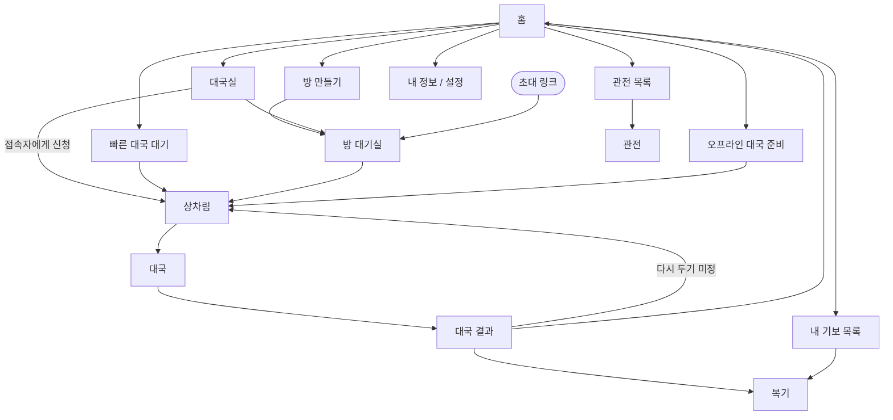

# 화면 기획

장기고의 화면 목록, 화면 사이의 이동, 화면별 구성이다. 글자·터치·색 기준은 [ui.md](./ui.md)를 따른다. 이 문서 전체가 **초안** 상태다. 항목별로 확정되면 표시를 바꾼다.

## 원칙 — 초안

- 40~60대 사용자가 처음 켜도 헤매지 않게 한다. 첫 화면에서 한 번 눌러 대국을 시작한다.
- 한 화면에는 한 가지 일만 시킨다. 선택지가 많은 설정은 기본값을 미리 골라 두고 바로 시작할 수 있게 한다.
- 온라인 대국, AI 대국, 오프라인 대국, 관전, 복기는 **같은 대국 화면**을 쓰고 모드에 따라 버튼만 바꾼다. 사용자가 판 화면을 한 번만 익히면 되게 하기 위해서다.
- 로그인이 필요한 기능은 누르는 순간에 로그인을 안내하고, 로그인이 끝나면 하려던 일로 돌아온다. 앱을 켜자마자 로그인을 강요하지 않는다.

## 화면 목록 — 초안

단계는 [plan.md](./plan.md)의 로드맵 단계다.

| 구분 | 화면 | 단계 | 로그인 |
|---|---|---|---|
| 공통 | 홈 | 1 | 불필요 |
| 공통 | 로그인 | 2 | — |
| 공통 | 닉네임 정하기 (첫 가입) | 2 | 필요 |
| 대국 준비 | 오프라인 대국 준비 (접장기, 초·한) | 1 | 불필요 |
| 대국 준비 | 빠른 대국 대기 | 2 | 필요 |
| 대국 준비 | 방 만들기 | 2 | 필요 |
| 대국 준비 | 방 대기실 | 2 | 필요 |
| 대국 준비 | 대국실 (방 목록, 접속자, 로비 채팅) | 2 | 필요 |
| 대국 준비 | 대국 신청 받음 팝업 | 2 | 필요 |
| 대국 | 상차림 | 1 | — |
| 대국 | 대국 | 1 | — |
| 대국 | 대국 결과 | 1 | — |
| 관전 | 관전 목록 | 2 | 불필요 |
| 관전 | 관전 (대국 화면의 관전 모드) | 2 | 불필요 |
| 기보 | 내 기보 목록 | 1 | 오프라인 기보는 불필요 |
| 기보 | 복기·놓아보기 (대국 화면의 복기 모드) | 1 | — |
| 내 정보 | 내 정보 (프로필, 급수, 전적) | 2 | 필요 |
| 내 정보 | 다른 사용자 정보 (신고, 차단, 대국 신청) | 2 | 필요 |
| 내 정보 | 설정 | 1 | 불필요 |
| 내 정보 | 차단 목록 | 2 | 필요 |
| 기타 | 상점 | 3 | 필요 |
| 기타 | AI 대국 준비 | 4 | 미정 |
| 기타 | AI 코치 | 4 | 필요 |
| 기타 | 박보장기 | 미정 | 미정 |

## 화면 흐름 — 초안

- 로그인이 필요한 화면(빠른 대국, 방 만들기, 대국실, 내 정보)으로 가려 하면 로그인 화면을 먼저 띄운다.
- 초대 링크로 들어온 사용자는 홈을 거치지 않고 방 대기실로 바로 간다. 로그인하지 않았으면 로그인을 거친 뒤 같은 방으로 돌아온다.

## 로그인 — 초안

- 앱 첫 실행에는 로그인을 띄우지 않고 바로 홈으로 간다. 홈의 내 카드 자리에 로그인 버튼과 "로그인하면 급수와 전적이 저장돼요" 안내를 둔다.
- 로그인을 띄우는 때: 빠른 대국, 방 만들기, 대국실 입장, 초대 링크로 방 입장, 관전 채팅, 내 정보, 홈의 로그인 버튼.
- 로그인 없이 되는 것: 오프라인 대국, 관전 보기, 오프라인 기보, 설정.
- 로그인이 끝나면 하려던 일을 사용자가 다시 누르지 않아도 바로 이어서 한다. 예를 들어 빠른 대국을 눌러 로그인했으면 곧바로 상대 찾기를 시작한다. 첫 가입이면 닉네임 정하기를 거친 뒤 이어서 한다.

### 로그인 창

- 전체 화면이 아니라 하던 화면 위에 아래에서 올라오는 창으로 띄운다. 뒤 화면은 어둡게 비친다.
- 제목은 하려던 일에 맞춘다. 예: 빠른 대국이면 "로그인하면 바로 상대를 찾아 드릴게요".
- 제목 아래에 로그인이 필요한 이유를 한두 줄로 적는다. 예: "온라인 대국은 로그인 후 둘 수 있어요. 급수와 전적이 저장돼요."
- 버튼은 위에서부터 Google, Apple, 이메일 순서로 같은 크기로 둔다. Google은 흰 바탕, Apple은 검은 바탕으로 각 회사의 로그인 버튼 지침을 따른다.
- 맨 아래에 "계속하면 이용약관과 개인정보처리방침에 동의하는 것으로 봅니다"를 두고 두 문서로 가는 링크를 단다. 따로 체크하는 단계는 두지 않는다.
- 오른쪽 위 닫기 버튼이나 창 바깥을 누르면 창을 닫고 하던 화면에 그대로 머문다.

### 이메일 로그인

- 이메일만 입력이 많아 전체 화면으로 넘어간다.
- 이메일과 비밀번호 칸, 비밀번호 보기 버튼, "비밀번호를 잊으셨나요?" 링크를 둔다.
- 로그인 버튼은 화면 아래쪽에 둔다. 그 아래에 "처음이신가요? 이메일로 가입하기"를 둔다.
- 이메일 가입 화면은 로그인 화면과 같은 구성에 비밀번호 확인 칸을 더한다.

## 닉네임 정하기 — 초안

- 첫 가입 때 한 번 보여준다. 뒤로가기 버튼은 두지 않는다.
- 제목은 "장기판에서 쓸 이름을 정해 주세요", 그 아래에 "대국 상대와 관전하는 사람에게 보여요"를 둔다.
- 입력칸에 글자 수(예: 3/10)를 보여주고, 입력하는 동안 쓸 수 있는지 바로 확인해 결과를 칸 아래에 보여준다.
- 그 아래에 대국 화면의 내 정보 줄처럼 꾸민 미리보기를 두어 내 이름이 대국에서 어떻게 보이는지 보여준다.
- 아래쪽에 시작하기 버튼을 두고, 하려던 일을 버튼 위에 한 줄로 알린다. 예: "정하고 나면 바로 상대를 찾아요".
- 닉네임 규칙은 미정이다. 시안은 한글·영문·숫자 2~10자, 중복 불가로 그렸다.

## 홈 — 초안

시안은 [ui.md](./ui.md)의 디자인 방향을 따른다. 버튼만 있는 화면이 아니라 볼거리가 채워진 화면으로 만든다.

- 아래쪽 탭: 홈, 대국실, 관전, 기보, 내 정보.
- 위에서 아래 순서:
  1. 진행 중인 온라인 대국이 있으면(앱이 꺼졌다 켜진 경우) "대국으로 돌아가기".
  2. 내 카드: 닉네임, 급수, 오늘 전적, 다음 급수까지 남은 승수 진행 막대. 로그인하지 않았으면 로그인 버튼.
  3. 빠른 대국 큰 버튼, 그 아래 방 만들기와 오프라인 대국 버튼.
  4. 지금 볼 만한 대국: 판 미리보기와 관전자 수가 있는 카드를 가로로 넘겨 본다.
  5. 최근 내 대국: 승패, 상대, 결과 종류와 복기 버튼.
- 설정은 내 정보 탭 안에 둔다. 상점은 오른쪽 위 아이콘으로 둔다(3단계).
- 방송 중 표시처럼 지원하지 않는 기능은 넣지 않는다.

## 대국 화면 — 초안

세로 화면 기준 위에서 아래 순서다.

| 영역 | 내용 |
|---|---|
| 상대 정보 줄 | 닉네임, 급수, 초·한 표시, 시계(기본 시간, 초읽기 남은 횟수), 남은 기물 점수 |
| 장기판 | 화면 너비를 가득 채운다. 내 진영이 아래 |
| 내 정보 줄 | 상대 정보 줄과 같은 구성 |
| 버튼 줄 | 한수쉼, 채팅, 메뉴 |

- 대국 화면은 어두운 바탕이다. 차례 표시, 고른 기물, 갈 수 있는 자리, 방금 둔 수의 표시는 [ui.md](./ui.md)의 "판 위 표시"를 따른다.
- 메뉴 안에 기권, 무승부 제안(미정), 소리 끄기, 판 돌리기를 둔다. 기권은 확인을 한 번 더 받는다.
- 모드별 차이:

| 모드 | 판 방향 | 버튼 줄 |
|---|---|---|
| 온라인 대국 | 내 진영이 아래 | 한수쉼, 채팅, 메뉴 |
| 오프라인 대국 | 미정 (아래 결정할 것 참고) | 한수쉼, 무르기, 메뉴 |
| 관전 | 초가 아래, 돌릴 수 있음 | 관전 채팅(로그인 시), 판 돌리기, 나가기 |
| 복기·놓아보기 | 내 진영이 아래 | 처음, 이전, 다음, 끝, 놓아보기 켜기/끄기 |

- 놓아보기: 복기 중 판에 직접 수를 두어 다른 수순을 시험한다. 놓아보기를 끄면 원래 기보 위치로 돌아간다.

## 대국 결과 — 초안

- 승패, 결과 종류(외통, 기권, 시간패, 점수승), 양쪽 점수를 보여준다.
- 온라인 대국이면 급수 변동을 보여준다.
- 버튼: 복기하기, 다시 두기(미정), 홈으로.
- 강제 광고는 넣지 않는다. 보상형 광고 버튼(4단계, AI 복기 추가)만 둔다([monetization.md](./monetization.md)).

## 결정할 것

- 오프라인 대국을 "혼자 두기(양쪽을 내가 둠)"와 "둘이 두기(폰 하나로 마주 보고)"로 나눌지. 마주 보고 둘 때 판 방향을 매 수 돌릴지, 위쪽 사람용 시계와 글자를 뒤집어 표시할지.
- 무르기를 어디까지 허용할지. [ui.md](./ui.md)에는 대국 화면 버튼으로 "무르기 요청"이 있지만 [game/rules.md](./game/rules.md)에는 무르기 규칙이 없다. 온라인 대국에서 무르기를 허용할지, 오프라인에서만 허용할지 정한다.
- 무승부 제안 기능을 둘지. 현재 규칙에는 합의 무승부가 없다.
- 오프라인 대국에 시계를 둘지, 둔다면 끌 수 있게 할지.
- 관전 목록 정렬 기준(급수 높은 순, 관전자 많은 순, 방송인 우선 등).
- 닉네임 규칙: 허용 글자와 길이, 중복 허용 여부, 욕설 검사를 [moderation.md](./moderation.md)의 검사와 연결할지, 나중에 바꿀 수 있게 할지.
- 처음 가입한 사용자의 시작 급수. 정해진 급수에서 시작할지, 가입할 때 실력을 물어볼지.
- 로그인 전에 둔 오프라인 기보를 로그인 뒤 계정으로 옮길지.
