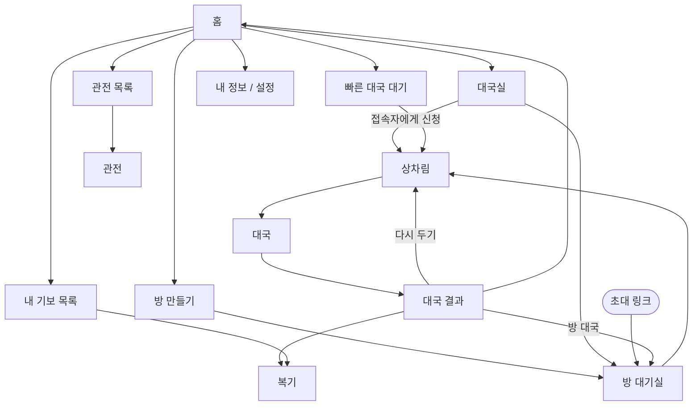

# 화면 기획

장기고의 화면 목록, 화면 사이의 이동, 화면별 구성이다. 글자·터치·색 기준은 [ui.md](./ui.md)를 따른다. 이 문서 전체가 **초안** 상태다. 항목별로 확정되면 표시를 바꾼다.

## 원칙 — 초안

- 40~60대 사용자가 처음 켜도 헤매지 않게 한다. 첫 화면에서 한 번 눌러 대국을 시작한다.
- 한 화면에는 한 가지 일만 시킨다. 선택지가 많은 설정은 기본값을 미리 골라 두고 바로 시작할 수 있게 한다.
- 온라인 대국, AI 대국, 관전, 복기는 **같은 대국 화면**을 쓰고 모드에 따라 버튼만 바꾼다. 사용자가 판 화면을 한 번만 익히면 되게 하기 위해서다.
- 로그인이 필요한 기능은 누르는 순간에 로그인을 안내하고, 로그인이 끝나면 하려던 일로 돌아온다. 앱을 켜자마자 로그인을 강요하지 않는다.

## 화면 목록 — 초안

단계는 [plan.md](./plan.md)의 로드맵 단계다.

| 구분 | 화면 | 단계 | 로그인 |
|---|---|---|---|
| 공통 | 홈 | 1 | 불필요 |
| 공통 | 로그인 | 2 | — |
| 공통 | 닉네임 정하기 (첫 가입) | 2 | 필요 |
| 대국 준비 | 빠른 대국 대기 | 2 | 필요 |
| 대국 준비 | 방 만들기 | 2 | 필요 |
| 대국 준비 | 방 대기실 | 2 | 필요 |
| 대국 준비 | 대국실 (방 목록, 접속자, 로비 채팅) | 2 | 필요 |
| 대국 준비 | 대국 신청 받음 팝업 | 2 | 필요 |
| 대국 | 상차림 | 1 | — |
| 대국 | 대국 | 1 | — |
| 대국 | 대국 결과 | 1 | — |
| 관전 | 관전 목록 | 2 | 불필요 |
| 관전 | 관전 (대국 화면의 관전 모드) | 2 | 불필요 |
| 기보 | 내 기보 목록 (새 판에서 놓아보기 버튼 포함) | 2 | 필요 |
| 기보 | 복기·놓아보기 (대국 화면의 복기 모드) | 1 | — |
| 내 정보 | 내 정보 (프로필, 급수, 전적) | 2 | 필요 |
| 내 정보 | 다른 사용자 정보 (신고, 차단, 대국 신청) | 2 | 필요 |
| 내 정보 | 설정 | 1 | 불필요 |
| 내 정보 | 차단 목록 | 2 | 필요 |
| 기타 | 상점 | 3 | 필요 |
| 기타 | AI 대국 준비 | 4 | 미정 |
| 기타 | AI 코치 | 4 | 필요 |
| 기타 | 박보장기 | 미정 | 미정 |

## 화면 흐름 — 초안

- 로그인이 필요한 화면(빠른 대국, 방 만들기, 대국실, 내 정보)으로 가려 하면 로그인 화면을 먼저 띄운다.
- 초대 링크로 들어온 사용자는 홈을 거치지 않고 방 대기실로 바로 간다. 로그인하지 않았으면 로그인을 거친 뒤 같은 방으로 돌아온다.

## 로그인 — 초안

- 앱 첫 실행에는 로그인을 띄우지 않고 바로 홈으로 간다. 홈의 내 카드 자리에 로그인 버튼과 "로그인하면 급수와 전적이 저장돼요" 안내를 둔다.
- 로그인을 띄우는 때: 빠른 대국, 방 만들기, 대국실 입장, 초대 링크로 방 입장, 관전 채팅, 기보, 내 정보, 홈의 로그인 버튼.
- 로그인 없이 되는 것: 관전 보기, 설정.
- 로그인이 끝나면 하려던 일을 사용자가 다시 누르지 않아도 바로 이어서 한다. 예를 들어 빠른 대국을 눌러 로그인했으면 곧바로 상대 찾기를 시작한다. 첫 가입이면 닉네임 정하기를 거친 뒤 이어서 한다.

### 로그인 창

- 전체 화면이 아니라 하던 화면 위에 아래에서 올라오는 창으로 띄운다. 뒤 화면은 어둡게 비친다.
- 제목은 하려던 일에 맞춘다. 예: 빠른 대국이면 "로그인하면 바로 상대를 찾아 드릴게요".
- 제목 아래에 로그인이 필요한 이유를 한두 줄로 적는다. 예: "온라인 대국은 로그인 후 둘 수 있어요. 급수와 전적이 저장돼요."
- 버튼은 위에서부터 Google, Apple, 이메일 순서로 같은 크기로 둔다. Google은 흰 바탕, Apple은 검은 바탕으로 각 회사의 로그인 버튼 지침을 따른다.
- 맨 아래에 "계속하면 이용약관과 개인정보처리방침에 동의하는 것으로 봅니다"를 두고 두 문서로 가는 링크를 단다. 따로 체크하는 단계는 두지 않는다.
- 오른쪽 위 닫기 버튼이나 창 바깥을 누르면 창을 닫고 하던 화면에 그대로 머문다.

### 이메일 로그인

- 이메일만 입력이 많아 전체 화면으로 넘어간다.
- 이메일과 비밀번호 칸, 비밀번호 보기 버튼, "비밀번호를 잊으셨나요?" 링크를 둔다.
- 로그인 버튼은 화면 아래쪽에 둔다. 그 아래에 "처음이신가요? 이메일로 가입하기"를 둔다.
- 이메일 가입 화면은 로그인 화면과 같은 구성에 비밀번호 확인 칸을 더한다.

## 닉네임 정하기 — 초안

- 첫 가입 때 한 번 보여준다. 뒤로가기 버튼은 두지 않는다.
- 제목은 "장기판에서 쓸 이름을 정해 주세요", 그 아래에 "대국 상대와 관전하는 사람에게 보여요"를 둔다.
- 입력칸에 글자 수(예: 3/10)를 보여주고, 입력하는 동안 쓸 수 있는지 바로 확인해 결과를 칸 아래에 보여준다.
- 그 아래에 대국 화면의 내 정보 줄처럼 꾸민 미리보기를 두어 내 이름이 대국에서 어떻게 보이는지 보여준다.
- 아래쪽에 시작하기 버튼을 두고, 하려던 일을 버튼 위에 한 줄로 알린다. 예: "정하고 나면 바로 상대를 찾아요".
- 닉네임은 한글·영문·숫자 2~10자이고 다른 사람과 같을 수 없다. 채팅과 같은 금칙어 검사([moderation.md](./moderation.md))를 거치고, "운영자"처럼 운영진을 사칭하는 단어는 쓸 수 없다.
- 처음 가입한 사용자는 18급에서 시작한다. 미리보기에도 18급으로 보여준다.

## 홈 — 초안

시안은 [ui.md](./ui.md)의 디자인 방향을 따른다. 버튼만 있는 화면이 아니라 볼거리가 채워진 화면으로 만든다.

- 아래쪽 탭: 홈, 대국실, 관전, 기보, 내 정보.
- 위에서 아래 순서:
  1. 진행 중인 온라인 대국이 있으면(앱이 꺼졌다 켜진 경우) "대국으로 돌아가기".
  2. 내 카드: 닉네임, 급수, 오늘 전적, 다음 급수까지 남은 승수 진행 막대. 로그인하지 않았으면 로그인 버튼.
  3. 빠른 대국 큰 버튼, 그 아래 방 만들기 버튼.
  4. 지금 볼 만한 대국: 판 미리보기와 관전자 수가 있는 카드를 가로로 넘겨 본다.
  5. 최근 내 대국: 승패, 상대, 결과 종류와 복기 버튼.
- 설정은 내 정보 탭 안에 둔다. 상점은 오른쪽 위 아이콘으로 둔다(3단계).
- 방송 중 표시처럼 지원하지 않는 기능은 넣지 않는다.

## 빠른 대국 대기 — 초안

대국 화면과 같은 어두운 바탕을 쓴다. 빠른 대국을 누른 순간부터 대국에 들어온 느낌을 주기 위해서다.

- **상대 찾는 중**
  - 가운데 내 프로필 둘레로 물결이 천천히 퍼진다. 휴대폰의 동작 줄이기가 켜져 있으면 멈춘다.
  - "상대를 찾고 있어요", "급수가 비슷한 상대와 바로 시작해요"와 기다린 시간을 보여준다.
  - 아래에 장기 규칙 한 줄 팁을 보여준다. 팁은 [game/rules.md](./game/rules.md) 등 규칙 문서의 내용만 쓴다.
  - 맨 아래에 "그만 찾기" 버튼을 둔다. 누르면 대기열에서 나와 홈으로 돌아간다.
  - 오래 기다릴 때의 AI 대국 제안([game/matching.md](./game/matching.md))은 AI 대국이 생기는 4단계에 넣는다.
- **상대 찾음**
  - 상대와 나를 위아래로 놓고 가운데에 VS를 둔다. 각자 닉네임, 급수, 초·한, 먼저 두는지 나중에 두는지를 보여준다.
  - 시간 규칙(기본 시간과 초읽기)과 급수 대국 여부를 보여준다.
  - 버튼 없이 진행 막대가 차면 상차림으로 넘어간다.

## 상차림 — 초안

규칙은 [game/rules.md](./game/rules.md)의 상차림을 따른다. 한이 먼저 정하고 초가 한의 상차림을 본 뒤 정한다.

- 대국 화면과 같은 판에 실제 기물을 놓고 보여준다.
- 아래에 네 가지 상차림을 2×2 버튼으로 둔다. 버튼에는 "마상마상" 같은 글자 없이 마·상 기물 그림 네 개만 고르는 사람 기준 왼쪽에서 오른쪽 순서로 놓는다. 화면 읽기 기능용 이름은 둔다.
- 버튼을 누르면 판 위 내 마·상 네 자리가 바로 바뀐다. 바뀌는 네 자리는 금빛으로 살짝 표시한다.
- 상대가 먼저 정했으면 상대 정보 줄에 "정했어요"와 상대의 마·상 기물 네 개를 화면에 놓인 순서대로 보여준다.
- 맨 아래 "이 상차림으로 정하기" 버튼을 누르면 확정한다. 확정하면 바꿀 수 없다.
- 상차림 제한 시간은 [game/time.md](./game/time.md)에서 정해지면 화면에 넣는다.

## 방 만들기 — 초안

조건은 [game/matching.md](./game/matching.md)의 방 만들기를 따른다. 밝은 화면이다.

- **내 진영**: 초 / 한 / 무작위. 기본은 무작위. 접장기를 켜면 떼는 쪽이 한을 잡으므로([game/handicap.md](./game/handicap.md)) 진영 선택은 꺼지고 "떼는 쪽이 한"으로 보여준다.
- **접장기**: 켜고 끄는 스위치. 켜면 아래가 펼쳐진다.
  - 떼는 쪽: 나 / 상대.
  - 뗄 기물: 차·마·상·상·마·차와 그 아래 포 두 개를 판에 놓이는 순서대로 기물 그림으로 늘어놓는다. 누르면 회색과 X 표시로 바뀐다([game/handicap.md](./game/handicap.md)).
  - 아래에 고른 결과를 한 줄로 요약한다. 예: "차 하나 떼기 · 13점 적게 시작".
- **방 목록에 공개**: 켜고 끄는 스위치. 끄면 초대 링크와 접속자 초대로만 들어온다. 비밀번호는 두지 않는다.
- **들어올 수 있는 급수**: 공개 방에서만 고른다. 기본은 모든 급수.
- 맨 아래 "방 만들기" 버튼을 누르면 방 대기실로 간다.

## 방 대기실 — 초안

- 위에 방 이름(예: "장기왕의 방")과 방 조건 칩(접장기, 초·한, 공개 여부와 급수)을 보여준다.
- 방장 자리와 상대 자리 카드를 위아래로 둔다. 상대가 없으면 점선 빈자리에 "상대를 기다리고 있어요"를 보여준다.
- 상대를 기다리는 동안 두 가지 부르는 방법을 같은 크기로 보여준다.
  - 초대 링크로 부르기: 링크 주소, 링크 복사, 카카오톡 공유 버튼.
  - 접속자 초대하기: 대국실 접속자 목록에서 닉네임을 검색해 신청을 보낸다.
- 상대가 들어오면 상대 자리에 닉네임과 급수를 보여주고, 방장에게 "내보내기" 버튼을 보여준다.
- 대국 시작은 방장만 누른다. 상대가 들어오기 전에는 "상대가 들어오면 시작할 수 있어요"로 꺼 둔다. 시작하면 상차림으로 간다.
- 왼쪽 위 뒤로 버튼은 방 나가기다. 방장이 나가면 방이 닫힌다.

## 대국실 — 초안

아래쪽 탭의 "대국실" 화면이다. 규칙은 [game/matching.md](./game/matching.md)의 방 목록, 로비와 신청을 따른다.

- 오른쪽 위에 방 만들기 버튼을 둔다.
- 방 목록 / 접속자 / 채팅 세 탭으로 나눠 한 번에 하나만 보여준다.
- **방 목록**: 한 줄에 방장 닉네임과 급수, 조건 칩(접장기, 초·한, 들어올 수 있는 급수), 입장 버튼을 둔다. 접장기 칩은 다른 색으로 눈에 띄게 한다. 열린 방이 없으면 진행 중인 대국 관전 목록을 대신 보여준다.
- **접속자**: 위에 닉네임 검색 칸, 접속자 수, 내 "신청 받기" 스위치를 둔다. 한 줄에 닉네임, 급수, 상태(기다리는 중, 대국 중, 신청 받지 않음)를 점 색과 글자로 함께 보여주고, 기다리는 중인 사람에게만 신청 버튼을 둔다.
- **채팅**: 로비 채팅. 아래 "채팅"의 메시지 모양을 밝은 색으로 쓴다.

## 대국 신청 — 초안

- **신청 보내기**: 접속자의 신청 버튼을 누르면 아래에서 올라오는 창을 띄운다. 상대 닉네임과 급수, 내 진영(초 / 한 / 무작위, 기본 무작위, 접장기면 떼는 쪽이 한), 접장기(기본 없음, 방 만들기와 같은 기물 고르기), 신청 보내기 버튼을 둔다.
- **신청 받음 팝업**: 앱의 어느 화면에서든 가운데에 띄운다. 신청한 사람의 닉네임과 급수, 조건 칩(접장기, 내 진영, 시간 규칙), 남은 응답 시간 막대, 거절·수락 버튼을 둔다. 수락하면 상차림으로 간다. 응답 시간이 지나면 신청을 취소하고 팝업을 닫는다.
- 응답 대기 시간과 연속 신청 제한 횟수는 [game/matching.md](./game/matching.md)에서 정한다.

## 대국 화면 — 초안

세로 화면 기준 위에서 아래 순서다.

| 영역 | 내용 |
|---|---|
| 상대 정보 줄 | 닉네임, 급수, 초·한 표시, 시계(기본 시간, 초읽기 남은 횟수), 남은 기물 점수 |
| 장기판 | 화면 너비를 가득 채운다. 내 진영이 아래 |
| 내 정보 줄 | 상대 정보 줄과 같은 구성 |
| 버튼 줄 | 한수쉼, 채팅, 메뉴 |

- 대국 화면은 어두운 바탕이다. 차례 표시, 고른 기물, 갈 수 있는 자리, 방금 둔 수의 표시는 [ui.md](./ui.md)의 "판 위 표시"를 따른다.
- 무르기는 없다.
- 상대 연결이 끊기면 상대 정보 줄에 "연결이 끊겼어요"와 이번 대국에서 남은 끊김 허용 시간(설정값 `disconnectLimitSeconds`에서 줄어드는 초)을 보여준다. 내 연결이 끊기면 판 위에 "다시 연결하는 중"을 보여주고 돌아오면 같은 대국에 자동으로 다시 붙는다([game/rules.md](./game/rules.md)의 접속 끊김).
- 메뉴 안에 기권, 소리 끄기, 판 돌리기를 둔다. 무승부 제안은 두지 않는다. 기권은 확인을 한 번 더 받는다.
- 모드별 차이:

| 모드 | 판 방향 | 버튼 줄 |
|---|---|---|
| 온라인 대국 | 내 진영이 아래 | 한수쉼, 채팅, 메뉴 |
| 관전 | 초가 아래, 돌릴 수 있음 | 관전 채팅, 판 돌리기, 나가기 |
| 복기·놓아보기 | 내 진영이 아래 | 처음, 이전, 다음, 끝, 놓아보기 켜기/끄기 |

- 놓아보기: 복기 중 판에 직접 수를 두어 다른 수순을 시험한다. 놓아보기를 끄면 원래 기보 위치로 돌아간다.
- 대국 중 놓아보기(대국하면서 따로 판을 펴 수를 미리 둬 보는 기능)는 두지 않는다. 급수가 걸린 대국에서 수 읽기를 돕는 기능이기 때문이다. 복기 놓아보기와 새 판에서 놓아보기는 무료다.
- 복기 모드: 시계 대신 양쪽의 남은 점수를 보여주고, 차례 표시와 기물 어두워짐은 쓰지 않는다. 마지막으로 둔 수는 대국 때와 같이 표시한다. 버튼 줄 위에 몇 수째인지(예: 4 / 87수)와 끌어서 옮기는 막대, 놓아보기 버튼을 둔다. 가장 많이 쓰는 이전·다음 버튼을 강조한다.
- 복기 화면에 글자로 된 수 목록은 넣지 않는다([game/notation.md](./game/notation.md)).
- 관전 모드: 위에 "관전 · N명 보는 중"을 보여준다. 남의 대국이므로 어느 쪽 기물도 어둡게 하지 않고, 차례는 시계와 남은 시간 막대로만 보여준다. 관전 채팅 버튼에 새 메시지 수를 표시한다. 버튼 줄 위에 하단 광고 배너 자리를 둔다([monetization.md](./monetization.md)).

## 내 기보 목록 — 초안

아래쪽 탭의 "기보" 화면이다.

- 날짜별(오늘, 어제, 날짜)로 묶는다.
- 한 줄에 끝난 판 미리보기, 상대와 급수, 결과 종류, 수, 승패 표시를 둔다.
- 누르면 복기로 간다.
- 위쪽에 "새 판에서 놓아보기" 버튼을 둔다. 처음 상차림(접장기 상차림 선택 가능)에서 양쪽을 자유롭게 두는 연구용 판이며, 복기 화면의 놓아보기와 같은 화면을 쓴다.
- 하단 광고 배너 자리를 둔다([monetization.md](./monetization.md)).

## 관전 목록 — 초안

아래쪽 탭의 "관전" 화면이다.

- 위에 진행 중인 대국 수를 보여준다.
- 대국을 두 줄 바둑판식 카드로 보여준다. 카드에는 판 미리보기, 관전자 수, 접장기 표시(해당 대국만), 양쪽 닉네임과 급수(漢·楚 표시), 몇 수째인지를 둔다.
- 기본 정렬은 관전자 많은 순이다. 관전자 수가 같으면 급수 높은 순으로 놓는다.
- 비공개 방의 대국은 목록에 보이지 않는다(확정, [game/matching.md](./game/matching.md)의 방 유지와 내보내기).
- 관전자 수에는 로그인하지 않은 관전자도 센다(확정).
- 10수가 안 된 대국은 뒤로 보낸다.
- 누르면 관전 모드로 간다.

## 채팅 — 초안

채팅 종류와 규칙은 [moderation.md](./moderation.md)를 따른다. 대국 채팅, 관전 채팅, 로비 채팅이 같은 메시지 모양을 쓴다.

- 대국 화면과 관전 화면에서는 아래에서 올라오는 창으로 연다. 창은 화면의 절반쯤 높이로 해서 판 윗부분이 보이게 한다.
- 다른 사람 메시지는 왼쪽에 닉네임과 함께, 내 메시지는 오른쪽 강조색 말풍선으로 보여준다.
- 검사에 걸려 보내지 못한 메시지는 가운데 회색 안내로 알린다.
- 입력칸 위에 자주 쓰는 말 버튼을 둔다. 관전 채팅은 "좋은 수네요", "응원합니다" 등, 대국 채팅은 "안녕하세요", "잘 부탁드립니다", "수고하셨습니다" 등.
- 다른 사람 메시지를 길게 누르면 신고·차단 메뉴를 띄운다. 그냥 누르면 아무 일도 하지 않는다. 실수로 신고·차단하지 않게 하기 위해서다.
- 차단은 "OO님을 차단할까요? 이 사람의 메시지와 대국 신청이 보이지 않아요" 확인을 한 번 더 받는다. 차단은 내 정보의 차단 목록에서 풀 수 있다.
- 채팅 창을 처음 열 때 "메시지를 길게 누르면 신고·차단할 수 있어요"를 한 번 안내한다.
- 대국 채팅 창에는 상대 채팅 끄기 버튼을 둔다.
- 대국 중에는 대국자에게 관전 채팅을 보여주지 않는다. 로그인하지 않은 관전자에게는 채팅 버튼 대신 "로그인하면 채팅할 수 있어요"를 보여준다.

## 대국 결과 — 초안

- 대국 화면을 어둡게 깔고 아래에서 결과 창을 올린다. 끝난 판을 뒤에 그대로 둔다.
- 승패, 결과 종류(외통, 기권, 시간패, 접속 끊김, 점수승), 수와 걸린 시간, 양쪽 점수를 보여준다.
- 온라인 대국이면 급수 변동을 보여준다. 급수 진행 막대에서 이번 대국으로 늘거나 줄어든 부분을 구분해 보여준다.
- 버튼: 한 판 더(새 빠른 대국, 가장 크게), 다시 두기(같은 상대, 둘 다 누르면 시작), 복기하기, 홈으로([game/matching.md](./game/matching.md)의 다시 두기).
- 방 대국은 결과 창을 나가면 홈 대신 방 대기실로 돌아간다(확정, [game/matching.md](./game/matching.md)의 방 유지와 내보내기).
- 강제 광고는 넣지 않는다. 보상형 광고 버튼(4단계, AI 복기 추가)만 둔다([monetization.md](./monetization.md)).

## 내 정보 — 초안

아래쪽 탭의 "내 정보" 화면이다.

- **프로필 카드**: 닉네임과 닉네임 바꾸기(연필) 버튼, 오늘 전적, 급수, 다음 급수까지 진행 막대.
- **전적**: 대국 수, 승, 패, 승률과 최근 10판의 승패.
- **메뉴**: 설정, 차단 목록, 상점(3단계).
- **닉네임 바꾸기**: 닉네임 정하기 화면을 그대로 쓰고 버튼만 바꾼다.
  - 첫 변경은 무료다. 두 번째부터 엽전을 쓴다([monetization.md](./monetization.md)).
  - 바꾼 뒤 7일 동안은 다시 바꿀 수 없다.
  - 이전 닉네임은 다른 사용자에게 보여주지 않는다. 변경 기록은 Admin 웹에서 볼 수 있게 남긴다.

## 다른 사용자 정보 — 초안

- 대국실 접속자, 채팅, 대국·관전 화면에서 다른 사람을 누르면 아래에서 올라오는 창으로 띄운다.
- 닉네임, 상태, 급수, 대국 수, 승률, 나와의 전적을 보여준다.
- 버튼: 대국 신청(크게), 차단, 신고. 차단은 확인을 한 번 더 받는다.

## 설정 — 초안

- **대국**: 소리, 진동([ui.md](./ui.md)의 연출), 대국 신청 받기(대국실의 스위치와 같은 설정).
- **계정**: 로그인 방식(누를 수 없는 정보 줄), 로그아웃, 회원 탈퇴. 로그인 방식은 앱을 다시 설치했을 때 어느 방식으로 가입했는지 잊지 않게 보여준다. 회원 탈퇴는 앱 안에서 할 수 있어야 한다(앱스토어 심사 기준).
- **정보**: 이용약관, 개인정보처리방침, 버전.
- 글자 크기는 휴대폰 설정을 따르므로 앱 설정에 두지 않는다. 수 확인 옵션은 두지 않는다.

## 차단 목록 — 초안

- 위에 "차단한 사람의 채팅 메시지와 대국 신청은 보이지 않아요"를 안내한다.
- 한 줄에 닉네임, 차단한 날짜, 차단 풀기 버튼을 둔다.
