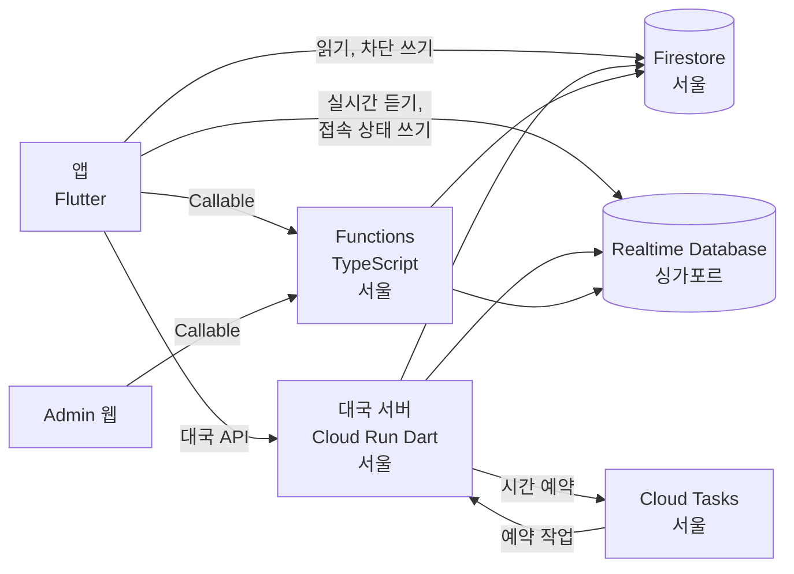
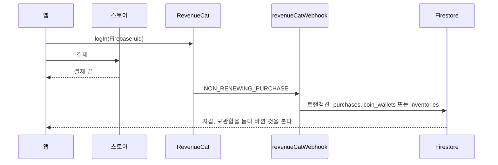
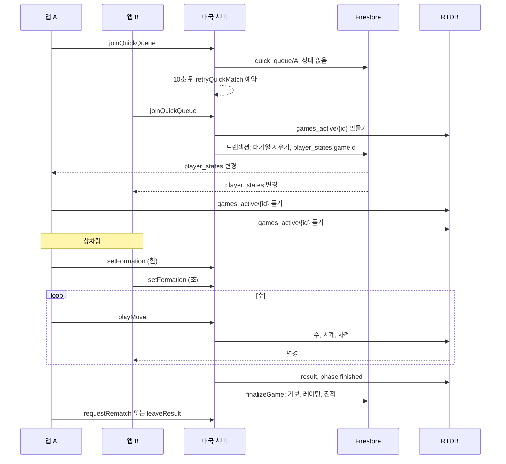

# 서버 설계

온라인 대국(로드맵 2단계)의 서버 구성, 대국 서버 API, 앱과 서버가 주고받는 흐름, 설정, 구현 순서다. 데이터 구조와 보안 규칙은 [database.md](./database.md)에 있다.

각 항목은 **확정**, **초안**, **제안**, **미정**으로 표시한다. 사용자와 정한 항목은 확정이고, 나머지 기술 설계는 구현하면서 확정한다.

## 구성 — 초안



| 구성 | 맡는 일 |
|---|---|
| 대국 서버 (`server/game`) | 대국 상태와 매칭에 관한 모든 쓰기. 빠른 대국, 방, 신청, 접속자 목록, 상차림, 수, 시계, 접속 끊김, 결과, 레이팅, 다시 두기, 참가비와 대국 보상 |
| Functions (`server/functions`) | 대국 밖의 서버 기능. 프로필과 닉네임, 가입·출석 엽전, 앱 결제 웹훅, 채팅 검사와 저장, 신고, 제재, Admin 웹 Callable, 보관 기간 정리 |
| 앱이 직접 쓰는 것 | 접속 상태(`connections`), 관전자 표시(`spectators`), 차단 목록, 신청 받기 설정 |
| Cloud Tasks | 대국 서버가 정한 시각에 대국 서버를 다시 부른다. 시간패, 상차림 마감, 접속 끊김 마감, 매칭 범위 넓히기, 신청 응답 마감 |

### 대국 서버와 Functions의 경계 — 초안

- 대국 상태(수, 시계, 결과, 급수)와 그 대국을 만드는 매칭 상태(대기열, 방, 신청, 사용자 활동)는 대국 서버만 쓴다. 한 사람이 대기열·방·대국·신청 중 하나에만 있도록 한 곳에서 관리하기 위해서다.
- Functions는 대국 상태를 쓰지 않는다. 채팅 권한을 확인할 때 대국 정보를 읽기만 한다. 예외로 회원 탈퇴를 처리할 때 `player_states`를 읽고, 탈퇴자를 지울 때 그 사람의 `player_states`, `ratings`, `rooms`, `challenges`를 지운다.
- `users/{uid}`는 둘이 함께 쓴다. 닉네임은 Functions, 급수와 전적은 대국 서버가 쓴다. 같은 필드를 둘이 쓰지 않는다.
- `coin_wallets/{uid}`는 둘이 같은 필드를 쓴다. 그래서 언제나 트랜잭션 안에서 읽고 쓴다(아래 "엽전").
- 제재 확인: 대국 서버는 대기열·방·신청을 시작할 때 이용 정지와 영구 정지를 확인하고, Functions는 채팅을 받을 때 채팅 제한까지 확인한다.

## 대국 서버 실행 방식 — 확정

- 대국 서버는 요청이 올 때만 실행한다. 진행 중 대국, 대기열, 방, 신청은 메모리에 두지 않고 모두 Firestore와 RTDB에 둔다. 요청마다 DB에서 읽어 판정하고 다시 쓴다.
- 요청 없이 시간이 지나서 일어나는 일(시간패, 상차림 마감, 접속 끊김 마감, 매칭 범위 넓히기, 신청 응답 마감)은 Cloud Tasks로 그 시각에 대국 서버를 다시 부르게 예약한다.
- 사용자가 늘면 Cloud Run이 인스턴스를 늘린다. 최소 인스턴스는 개발과 출시 모두 0으로 둔다. 꺼져 있다가 첫 요청에 켜지는 지연(1초 안팎)이 생기므로, 사용자가 어느 정도 생기면 운영자가 판단해 1로 올린다. 코드는 바꾸지 않고 배포 설정만 바꾼다: `gcloud run services update game --region asia-northeast3 --min-instances 1`.
- 리전은 `asia-northeast3`(서울)이다.

### 동시에 들어온 요청 — 초안

- 한 대국 안의 변경은 RTDB `games_active/{gameId}` 노드 전체를 ETag 조건부 쓰기로 바꾼다. 다른 요청이 먼저 썼으면 다시 읽고 다시 판정한다.
- 여러 사람이 걸린 매칭(대기열, 방 입장, 신청 수락, 다시 두기)은 Firestore 트랜잭션으로 `player_states`, `quick_queue`, `rooms`, `challenges`를 한꺼번에 바꾼다.
- 대국을 만들 때는 RTDB에 대국을 먼저 쓰고 Firestore 트랜잭션으로 두 사람을 그 대국에 묶는다. 트랜잭션이 실패하면 만든 대국을 지운다. 중간에 서버가 멈춰 어느 쪽에도 묶이지 않은 대국은 정리 작업이 지운다.
- RTDB의 파생 데이터(`spectate_list`, `online_users`)는 대국 상태를 쓴 뒤에 따라 쓴다.

### 호출 방식 — 초안

- 앱은 Functions Callable과 같은 프로토콜로 대국 서버를 부른다. Flutter의 `httpsCallableFromUrl`을 그대로 쓰기 위해서다.
  - 요청: `POST {서버 주소}/{API 이름}`, 본문 `{"data": {...}}`, `Authorization: Bearer <Firebase ID token>`.
  - 성공: `{"result": {...}}`.
  - 실패: `{"error": {"status": "FAILED_PRECONDITION", "message": "...", "details": {"code": "<오류 코드>"}}}`.
- 대국 서버는 Firebase ID token을 직접 검증한다(Google 공개 키, `aud`·`iss`가 프로젝트와 같은지). 에뮬레이터에서는 에뮬레이터 토큰을 받는다.
- 예약 작업 경로(`/tasks/...`)는 Cloud Tasks 서비스 계정의 OIDC 토큰만 받는다.
- 요청 파라미터는 API별 `validateParams()`에서 검증한다([dev_rules.md](./dev_rules.md)의 Dart 대국 서버 규칙).
- 앱은 오류 코드로 다국어 메시지를 고르고, 모르는 코드는 그 작업의 기본 오류 메시지로 보여준다.

| 오류 코드 | 뜻 |
|---|---|
| `profileRequired` | 닉네임을 아직 정하지 않았다 |
| `sanctioned` | 이용 정지 또는 영구 정지 중이다 |
| `busy` | 이미 대기열, 방, 대국, 신청 중 하나에 있다 |
| `notFound` | 방, 대국, 신청이 없다 |
| `roomFull` | 방에 자리가 없다 |
| `roomClosed` | 방이 닫혔다 |
| `kicked` | 이 방에서 내보내졌다 |
| `rankOutOfRange` | 방의 급수 범위 밖이다 |
| `notHost` | 방장만 할 수 있다 |
| `notPlayer` | 이 대국의 대국자가 아니다 |
| `notYourTurn` | 내 차례가 아니다 |
| `illegalMove` | 둘 수 없는 수다 |
| `moveConflict` | 수 번호가 서버와 다르다. 앱은 서버 상태로 다시 맞춘다 |
| `gameOver` | 이미 끝난 대국이다 |
| `challengeLimited` | 이 상대에게 지금은 신청할 수 없다(연속 거절 제한) |
| `targetUnavailable` | 상대가 접속해 있지 않거나, 대국 중이거나, 신청을 받지 않거나, 다른 신청을 받고 있다 |
| `rematchUnavailable` | 상대가 나갔거나 다시 두기 횟수에 닿았다 |
| `extensionLimit` | 시간 연장을 더 쓸 수 없다 |
| `coinsInsufficient` | 내 엽전이 내야 할 값보다 적다 |
| `opponentCoinsInsufficient` | 상대의 엽전이 참가비보다 적다 |
| `coinPriceChanged` | 앱이 보여준 값이 지금 값과 다르다 |
| `featureDisabled` | 운영 스위치로 멈춘 기능이다 |
| `gamesBlocked` | `configs/app.serviceNotice.gamesBlocked`로 새 대국을 막았다 |

## 대국 서버 API — 초안

모든 API는 로그인과 닉네임(`users/{uid}`)이 있어야 한다. `users.deletedAt`이 있으면 닉네임이 없는 것으로 본다(`profileRequired`). 요청에 `Origin` 헤더가 있고 `configs/app.webEnabled`가 꺼져 있으면 `featureDisabled`다(아래 "운영 스위치").

### 접속자

| API | 파라미터 | 하는 일 |
|---|---|---|
| `enterLobby` | 없음 | `online_users/{uid}`에 닉네임, 급수, 상태, 신청 받기를 쓴다. 앱이 로그인 상태로 RTDB에 연결될 때마다, 다른 앱에서 돌아올 때마다 부른다. 상태는 `player_states.gameId`가 있으면 `playing`, 신청 받기는 `users_private.challengesEnabled`(문서가 없으면 false)다. 이미 있으면 새로 쓴다 |

### 빠른 대국

| API | 파라미터 | 하는 일 |
|---|---|---|
| `joinQuickQueue` | 없음 | 대기열에 넣고 바로 한 번 매칭을 시도한다. 상대가 없으면 범위 넓히기 작업을 예약한다. 결과 `gameId`(찾았으면 새 대국, 아니면 null). 이미 대기열에 있으면 기다린 시간을 그대로 두고 다시 찾기만 한다. 이용 정지 중이면 `sanctioned`, 방·대국·신청 중이면 `busy` |
| `leaveQuickQueue` | 없음 | 대기열에서 뺀다. 이미 매칭됐으면 `busy`. 대기열에 없으면 그대로 성공한다 |

### 방

| API | 파라미터 | 하는 일 |
|---|---|---|
| `createRoom` | `hostSide`, `handicap?`(`remover`, `pieces`), `listed`, `rankRange?`(`min`, `max`) | 방을 만들고 `roomId`를 돌려준다. `pieces`는 서로 다른 기물 1개 이상, `rankRange`는 공개 방에서만 준다. 이용 정지 중이면 `sanctioned`, 대기열·방·대국·신청 중이면 `busy` |
| `joinRoom` | `roomId` | 빈자리에 앉는다. 링크, 방 목록 모두 이것을 쓴다. 이미 이 방에 있으면 그대로 성공한다. 방이 없으면 `notFound`, 닫혔으면 `roomClosed`, 내보내진 사람이면 `kicked`, 자리가 찼으면(대국 중 포함) `roomFull`, 급수 범위 밖이면 `rankOutOfRange`, 다른 것을 하고 있으면 `busy`, 이용 정지 중이면 `sanctioned` |
| `leaveRoom` | `roomId` | 방에서 나간다. 방장이면 방을 닫고 상대도 방에서 뺀다. 이미 나갔으면 그대로 성공한다. 방의 대국이 진행 중이면 `busy` |
| `kickGuest` | `roomId` | 방장이 상대를 내보낸다. 내보낸 사람은 방이 닫힐 때까지 못 들어온다. 상대가 없으면 그대로 성공한다. 방장이 아니면 `notHost`, 대국 중이면 `busy` |
| `startRoomGame` | `roomId` | 방장이 대국을 시작한다. `gameId`를 돌려준다. 이미 대국 중이면 그 대국 ID를 돌려준다. 방장이 아니면 `notHost`, 상대가 없으면 `notFound`, 닫힌 방이면 `roomClosed` |

### 신청

| API | 파라미터 | 하는 일 |
|---|---|---|
| `sendChallenge` | `toUid`, `senderSide?`, `handicap?`, `roomId?` | 신청을 만들고 응답 마감 작업을 예약한다. 결과 `challengeId`. 접장기면 `handicap`만, 아니면 `senderSide`만 준다. `roomId`가 있으면(방 초대) 방 조건을 쓰므로 둘 다 주지 않는다. 이용 정지 중이면 `sanctioned`, 대기열·방·대국·신청 중이면 `busy`(방 초대는 그 방의 방장만 보낸다. 아니면 `notHost`, 방이 찼으면 `roomFull`, 닫혔으면 `roomClosed`), 연속 거절 제한이면 `challengeLimited`, 받는 사람이 대국실에 없거나 신청 받기를 껐거나 방·대국·다른 신청 중이거나 내가 차단한 사람이면 `targetUnavailable` |
| `cancelChallenge` | `challengeId` | 보낸 사람이 취소한다. 이미 끝난 신청이면 그대로 성공한다. 내가 보낸 신청이 아니면 `notFound`. 연속 거절 횟수는 세지 않는다 |
| `respondChallenge` | `challengeId`, `accepted` | 받은 사람이 수락하거나 거절한다. 수락하면 대국을 만들거나(`roomId` 없음) 방에 앉힌다. 결과 `gameId`(만든 대국), `roomId`(들어간 방). 거절이면 둘 다 null. 신청이 없거나, 내가 받은 신청이 아니거나, 끝났거나, 응답 마감이 지났으면 `notFound`. 수락하는데 이용 정지 중이면 `sanctioned`, 초대한 방이 닫혔으면 `roomClosed`, 그새 다른 사람이 들어왔으면 `roomFull`이고 이때 신청은 `cancelled`가 된다 |

### 대국

| API | 파라미터 | 하는 일 |
|---|---|---|
| `setFormation` | `gameId`, `formation`, `confirmed` | 상차림을 골라 둔다(`confirmed: false`, `player_states.setupDraft`에 저장) 또는 확정한다 |
| `playMove` | `gameId`, `moveIndex`, `move` | 수 또는 `pass`를 둔다. `moveIndex`는 이 수가 몇 번째 수인지(0부터)다. 같은 수를 다시 보내면 성공으로 본다 |
| `resign` | `gameId` | 기권한다 |
| `useTimeExtension` | `gameId`, `extensionIndex`, `coinCost` | 엽전을 내고 시간 연장을 쓴다. `extensionIndex`는 앱이 본 `clock.extensionsUsed`(0부터), `coinCost`는 앱이 보여준 값이다. 같은 번호를 다시 보내면 성공으로 본다. 아래 "시간 연장과 놓아보기" |
| `useGamePractice` | `gameId`, `coinCost` | 이 판의 놓아보기 값을 낸다. 이미 냈으면 다시 받지 않고 성공한다. 아래 "시간 연장과 놓아보기" |
| `checkGame` | `gameId` | 대국 판정을 다시 보게 한다(아래 "판정 다시 보기"). 대국자만 부를 수 있고, 끝난 대국이면 아무것도 하지 않고 성공한다. 앱이 부르는 때는 아래 "접속 끊김" |
| `requestRematch` | `gameId` | 다시 두기를 누른다. 두 사람이 모두 누르면 새 대국을 만든다. 결과 `gameId`(새 대국이 정해졌으면 그 ID, 상대를 기다리면 null). 끝나지 않은 대국, 상대가 나갔거나 앱에 없을 때, 횟수에 닿았을 때는 `rematchUnavailable` |
| `leaveResult` | `gameId` | 결과 화면을 나간다. 기다리던 다시 두기를 취소하고, 방 대국이면 방 대기실로 돌린다. 대국이 이미 지워졌으면 그대로 성공한다 |

### 예약 작업 (Cloud Tasks 전용)

| 경로 | 예약하는 때 | 하는 일 |
|---|---|---|
| `/tasks/evaluateGame` | 상차림 마감, 시간패 시각, 접속 끊김 마감 | 판정 다시 보기 |
| `/tasks/retryQuickMatch` | 대기열에 들어간 뒤 10초마다 | 넓어진 범위로 다시 매칭. 앱 연결이 모두 끊겼으면 대기열에서 뺀다 |
| `/tasks/expireChallenge` | 신청 응답 마감 | 응답이 없으면 `expired`로 바꾸고 두 사람의 신청 표시를 지운 뒤 제한 횟수를 센다. 이미 끝났으면 아무것도 하지 않는다 |
| `/tasks/finalizeGame` | 대국이 끝날 때 | 기보 저장, 레이팅·전적 반영. 실패하면 Cloud Tasks가 다시 부른다 |
| `/tasks/cleanupGame` | 대국을 만들 때, 끝날 때 | 묶이지 않은 대국과 끝난 지 오래된 대국을 RTDB에서 지운다 |
| `/tasks/checkRoom` | 방을 만든 시각부터 1분마다, 방이 닫힐 때까지 | 방장 연결이 `roomAbsentSeconds` 넘게 없으면 방을 닫고, 상대가 그만큼 없으면 자리를 비운다. 대국 중에는 확인하지 않고 다음을 예약한다 |

예약 시각은 정확하지 않을 수 있다. 판정은 항상 서버가 받은 시각이 아니라 기록된 시각(마감 시각)으로 계산하므로 작업이 늦게 돌아도 결과는 같다.

## 대국 진행 — 초안

### 판정 다시 보기

`evaluateGame`(예약 작업)과 `checkGame`(앱), 그리고 모든 대국 API는 처음에 같은 판정을 한다.

1. 지금 시각까지 지나간 사건을 시각 순서대로 찾는다. 상차림 마감, 시간패 시각, 각 쪽의 접속 끊김 마감.
2. 가장 이른 사건부터 적용한다. 예를 들어 한의 상차림 마감이 지났으면 `setupDraft` 또는 기본값(마상마상)으로 확정하고, 초의 상차림 시간은 지금이 아니라 한의 마감 시각부터 센다.
3. 대국이 끝나는 사건을 만나면 거기서 멈춘다.
4. 다음 사건 시각에 `evaluateGame`을 예약한다.

### 대국 만들기와 상차림

- 대국을 만들 때 `meta`에 대국자, 시간 규칙, `disconnectLimitMs`, 접장기를 고정한다.
- 상차림은 대국을 만들자마자 시작한다. 상대 찾음 화면은 없앴다(2026-11-03, [screens.md](./screens.md)의 빠른 대국 대기). `setup.startsAt` = 만든 시각이다. 방 대국과 신청 대국도 같다.
- 한이 먼저 고르고 초는 한의 상차림이 확정된 뒤 고른다([rules.md](./game/rules.md), [time.md](./game/time.md)). 확정된 한의 상차림만 `state.setup.han`에 쓴다. 골라 두기만 한 것은 `player_states.setupDraft`에 둬서 상대에게 보이지 않게 한다.
- 양쪽이 확정되면 `janggi_core`의 `createInitialPosition`으로 `initialFen`을 만들고 초의 차례를 시작한다.

### 수

1. 차례, `moveIndex`, 대국 진행 여부를 확인한다.
2. `initialFen`과 `moves`로 `Game.replay`를 해서 `Game.isLegal`로 검사한다. 수 판정은 `janggi_core`만 쓴다.
3. 받은 시각으로 둔 쪽의 시계를 계산한다(아래 "시계"). 시간이 이미 다 지났으면 수를 받지 않고 시간패로 끝낸다.
4. 수를 붙이고 차례와 `turnStartedAt`을 바꾼다. `Game.play` 결과가 끝난 대국이면(외통, 점수 판정) 결과를 쓴다.
5. `spectate_list`의 국면, 수, 관전자 수를 갱신한다.

앱은 수를 보내자마자 자기 판에 먼저 보여주고, 서버가 거절하면 서버 상태로 되돌린다.

### 시계

[time.md](./game/time.md)를 서버가 계산한다. 앱은 같은 식으로 표시만 한다. 앱은 RTDB `.info/serverTimeOffset`으로 서버 시각을 어림한다.

- 차례가 시작될 때 둘 쪽의 `baseMs`(남은 기본 시간)와 `periods`(남은 초읽기 횟수)를 기록한다. 시간 연장을 쓰면 그때 `periods`가 늘어난다.
- 그 차례에 쓴 시간 `spent` = 수를 받은 시각 − `turnStartedAt`.
- `spent`가 `baseMs` 이하면 `baseMs`에서 뺀다.
- 넘으면 `over` = `spent` − `baseMs`, `baseMs` = 0, 초읽기 횟수를 `over ÷ periodMs`의 몫만큼 줄인다. 30초 안에 두면 줄지 않는다.
- 시간패 시각 = `turnStartedAt` + `baseMs` + (`periods` + 1) × `periodMs`. "초읽기 3회를 모두 쓴 뒤 30초 안에 두지 못하면 시간패"를 그대로 계산한 값이다.
- 한수쉼도 한 수로 시계를 넘긴다.
- 네트워크 지연을 보정하지 않는다. 서버가 받은 시각이 기준이다.

### 접속 끊김

[rules.md](./game/rules.md)의 접속 끊김을 서버가 판정한다.

- 앱은 로그인한 동안 RTDB `connections/{uid}/{connectionId}`에 접속 상태를 쓴다(`ConnectionManager`).
  - 로그인한 동안 자기 `connections/{uid}`를 계속 듣는다. 안드로이드 RTDB SDK는 서버에서 듣는 경로가 없으면 60초 뒤 연결을 닫아서, 홈·빠른 대국 대기·방 대기실처럼 Firestore만 듣는 화면에서 끊긴 것으로 보이기 때문이다.
  - RTDB에 연결될 때마다(`.info/connected`) 지난 연결 키를 지우고 새 연결에 `online: true`, `foreground`, `activeSince`·`lastSeenAt`(서버 시각)을 쓴 뒤 `onDisconnect`로 `online: false`를 걸어 둔다. 보안 규칙이 연결의 필드를 모두 요구하므로 연결을 쓴 뒤에 건다.
  - 진행 중 대국(`player_states.gameId`, 상차림 포함)이 있는 동안 `heartbeatSeconds`마다 `lastSeenAt`을 갱신한다. 대국이 생기면 바로 한 번 쓴다.
  - 웹은 탭이 숨겨져도 `foreground: false`를 쓰지 않는다([rules.md](./game/rules.md)의 접속 끊김). 숨긴 탭은 브라우저가 타이머를 늦춰(크롬은 5분 넘게 숨기면 1분에 한 번) `lastSeenAt` 갱신이 늦어질 수 있으므로, 웹 연결이 `presenceStaleSeconds` 때문에 끊긴 것으로 잘못 보이지 않게 한다(확정, 2026-11-04).
    - 웹은 연결에 `tabHidden`을 더 쓴다. 탭이 숨겨지면(`hidden`, `paused`) `tabHidden: true`와 `lastSeenAt`을, 다시 보이면 `tabHidden: false`와 `activeSince`·`lastSeenAt`을 쓰고 대국 중이면 `checkGame`을 부른다. 연결을 새로 만들 때도 그때 탭이 숨겨져 있는지 쓴다. `foreground`는 늘 true로 두고 heartbeat도 멈추지 않는다.
    - 서버는 `tabHidden`이 true인 연결은 `lastSeenAt`이 오래됐는지 보지 않고 `online`만 본다. 숨긴 탭은 브라우저가 타이머를 늦추거나 아예 멈추기 때문이다. 에뮬레이터 확인에서 앱의 내장 브라우저는 숨긴 탭의 heartbeat를 1분도 안 돼 멈췄다. 어떤 기준을 두어도 숨겨 둔 것만으로 끊긴 것으로 볼 수 있어 기준을 두지 않는다. 탭이 보이는 웹과 앱은 `presenceStaleSeconds` 그대로다.
    - 숨긴 탭은 마지막 heartbeat가 끊긴 시각이 아니므로, 숨겨지면 `onDisconnect`에 `lastSeenAt`(서버 시각)을 더 걸어 둔다. 탭이나 브라우저를 닫거나 RTDB가 네트워크 끊김을 알아채면 `online: false`와 그 시각이 `lastSeenAt`에 쓰여 그때부터 센다. 이미 걸어 둔 `online: false`는 지우지 않고 더 건다. 지운 사이에 끊기면 숨긴 탭이 계속 연결된 것으로 남기 때문이다. 다시 보이면 걸어 둔 것을 지우고 `online: false`만 다시 건다. 그 사이에 끊겨도 보이는 탭은 `presenceStaleSeconds`로 알아챈다.
    - 그래서 숨긴 탭의 네트워크가 갑자기 끊기면 RTDB 서버가 알아챈 시각부터 센다. 실제로 끊긴 시각보다 늦어 끊긴 쪽에 유리하다. 숨긴 탭이 끊긴 것으로 잘못 판정되는 것보다 낫다고 보았다. 휴대폰 브라우저처럼 숨긴 페이지를 멈추는 브라우저도 RTDB 연결이 살아 있는 동안은 연결된 것으로 본다. 그래도 시계는 흐르므로 오래 비우면 시간패가 난다.
    - 고르지 않은 방법: 플랫폼만 기록해 웹 연결 전부에 긴 기준을 쓰면 탭을 보고 있는 웹의 네트워크 끊김을 늦게 알아채고, 숨긴 탭의 타이머가 멈추면 그 기준도 넘는다. `onDisconnect`에 늘 `lastSeenAt`을 걸면 앱과 보이는 웹도 RTDB가 알아챈 시각부터 세게 되어 마지막으로 살아 있던 시각부터 센다는 원칙과 어긋난다.
    - 옛 웹은 `tabHidden`을 쓰지 않으므로 `presenceStaleSeconds` 기준을 그대로 쓴다. 상대 앱의 `checkGame` 계기와 다시 두기·빠른 대국의 "앱에 있는지"는 `online`이고 `foreground`인 연결을 보므로 숨긴 웹 탭은 앱에 있는 것으로 보고 바꾸지 않았다. 로비 접속자 목록(`online_users`)은 지금처럼 탭이 보일 때만 올린다.
  - 다른 앱으로 넘어가면(앱 생명주기 `hidden`, `paused`) `foreground: false`와 `lastSeenAt`을 쓴다. 돌아오면(`resumed`, `inactive`) `foreground: true`와 `activeSince`를 쓴다.
- 서버는 대국자의 연결 중 `online`이고 `foreground`이며 `lastSeenAt`이 `presenceStaleSeconds` 안인 것(숨긴 웹 탭은 오래됐는지 보지 않는다)이 하나라도 있으면 연결된 것으로 본다.
- 판정 다시 보기마다 두 대국자의 `connections`를 읽어 `state.disconnect`를 그 시각에 맞춘다.
  - 끊긴 시각은 그 사람의 가장 최근 `lastSeenAt`이다. 네트워크가 갑자기 끊겨 RTDB가 늦게 알아채도 마지막으로 살아 있던 시각부터 센다. 대국을 만든 시각보다 앞이면(연결 기록이 없을 때 포함) 만든 시각으로 한다.
  - 끊긴 시각보다 뒤의 `activeSince`가 있는 연결이 있으면 그중 가장 이른 `activeSince`에 돌아온 것으로 보고 끊긴 시간(`activeSince` − 끊긴 시각)을 `usedMs`에 더한다. 그 연결이 다시 끊겨 있으면(서버가 돌아온 것을 보지 못한 사이 다시 나간 경우) 가장 최근 `lastSeenAt`부터 다시 센다.
  - 연결되어 있는데 끊긴 시각보다 뒤의 `activeSince`가 없으면(네트워크가 잠깐 멈췄다가 RTDB 연결이 바뀌지 않고 이어진 경우) 끊긴 시간을 더하지 않고 끊김을 지운다. 이렇게 되지 않도록 앱은 서버가 자기를 끊긴 것으로 기록했는데 자기는 연결되어 있으면 `activeSince`를 새로 쓰고 `checkGame`을 부른다.
  - 돌아오기 전에 `usedMs` + 끊긴 시간이 `disconnectLimitMs`에 닿았으면 돌아왔어도 그 시각에 진다.
- `usedMs` + 지금 끊겨 있는 시간이 `disconnectLimitMs`에 닿으면 끊긴 쪽이 진다. 그 시각에 `evaluateGame`을 예약한다.
- 서버는 끊김을 스스로 알 수 없으므로 판정을 다시 보는 계기가 필요하다. 앱은 대국 화면과 상차림 화면에서 다음을 보면 `checkGame`을 부른다. 같은 서버 상태(`state.version`)에서는 같은 까닭으로 한 번만 부른다.
  - 상대의 `connections`에 `online`이고 `foreground`인 연결이 없는데 서버 기록에 상대 끊김이 없을 때.
  - 상대가 돌아왔는데(`online`이고 `foreground`인 연결이 있다) 서버 기록에 상대 끊김이 남아 있을 때.
  - 서버 기록에 내 끊김이 있는데 나는 연결되어 있을 때(먼저 `activeSince`를 새로 쓴다).
  - 상대 시계가 0이 되었을 때(차례마다 한 번).
  - 진행 중 대국이 있는 동안 RTDB에 다시 연결되거나 다른 앱에서 돌아왔을 때(돌아온 앱, 화면과 상관없이).
  - 둘 다 끊기면 시간패 예약 작업이 판정한다. 그때 접속 끊김 마감과 시간패 중 먼저 온 것으로 끝낸다. 같은 시각이면 시간패다.
- 상대의 수, 상차림 같은 다른 대국 API도 처음에 같은 판정을 하므로 그때도 끊김을 기록한다.
- 누가 `checkGame`을 부르든 서버는 RTDB의 접속 기록만 보고 판정하므로 부른 사람이 결과를 바꿀 수 없다.
- 상차림 시간에도 끊긴 시간을 센다. 끊긴 동안에도 시계는 흐른다.
- 앱의 표시는 서버 기록(`state.disconnect`)과 대국을 만들 때 정한 `meta.disconnectLimitMs`로 한다. 상대 끊김은 상대 정보 줄에 남은 허용 시간을, 내 기기의 RTDB 연결이 끊기면 판 위에 "다시 연결하는 중"을 보여준다([screens.md](./screens.md)의 대국 화면).

### 기권

- 대국 중(상차림 포함) 언제든 할 수 있다. 상차림 중 기권도 패로 기록한다.

### 결과와 레이팅

1. 결과(`result`, `endedAt`)를 RTDB에 쓰고 `phase`를 `finished`로 바꾼다. `spectate_list`에서 지운다.
2. `finalizeGame`을 예약하고 바로 한 번 실행한다. Firestore 트랜잭션 하나로 다음을 한다. `games_archived/{gameId}`가 이미 있으면 아무것도 하지 않는다(한 번만 반영).
   - `games_archived/{gameId}` 만들기.
   - `users/{uid}.stats` 갱신. 온라인 대국은 종류(빠른 대국, 방, 신청)와 급수 대국 여부에 상관없이 모두 센다(2026-11-03 구현). 급수 대국이면 바뀐 `rankLevel`도 같은 쓰기에 담는다.
   - 급수 대국이면 `ratings` 갱신, `users.rankLevel`, `users_private.rankProgress`·`winsToNextRank`, `player_states.lastRankChange` 쓰기.
   - `player_states.gameId`를 비우고 `lastGameId`를 쓴다.
   - 대국 보상을 주거나 참가비를 돌려준다(아래 "엽전").
3. `online_users`의 상태를 `waiting`으로 돌린다.

레이팅은 [rank.md](./game/rank.md)의 Elo를 쓴다.

- 기대 승률 E = 1 / (1 + 10^((상대 레이팅 − 내 레이팅) / 400)).
- 변동 = K × (결과 − E). 결과는 이기면 1, 지면 0이다. K는 이 대국 전의 내 `ratedGames`로 고른다. 레이팅은 소수 그대로 저장한다.
- 급수는 바뀐 레이팅이 들어가는 구간으로 바로 정한다.
- 진행 막대(`rankProgress`) = (레이팅 − 지금 급수 구간의 시작) ÷ 50을 0~1로 자른 값. 18급 구간은 1000부터 센다(1000 아래면 0). 9단은 다음 급수가 없으므로 1이다.
- 어림 승수 = (다음 급수 시작 레이팅 − 지금 레이팅) ÷ (K × 0.5)를 올림한 값이고 1보다 작지 않다. K는 다음 판의 K다. 비슷한 레이팅의 상대를 이기면 K의 절반쯤 오른다는 어림이다. 9단이면 null.
- 급수 변동(`lastRankChange`)의 "전" 값은 이 대국 전 레이팅으로 계산한다. `ratings` 문서가 없으면 처음 레이팅(1000)이다.
- 급수 대국은 빠른 대국(다시 두기 포함)이고 접장기가 아닌 대국이다. 대국을 만들 때 `meta.rated`에 정한다.
- `users_private` 문서가 없으면(Functions가 프로필과 함께 만드는 문서라 정상이면 없다) 급수 진행만 쓰지 않고 나머지는 반영한다. 대국 마무리를 막지 않기 위해서다.

### 엽전 — 확정 (2026-11-06 구현)

숫자와 규칙은 [monetization.md](./monetization.md)의 엽전, 저장 구조는 [database.md](./database.md)의 `coin_wallets`, `coin_transactions`다. 계산은 대국 서버의 `coin_rules.dart`와 Functions의 `coinService.ts`에 있다.

| 일 | 어디서 | 언제 |
|---|---|---|
| 가입 지급 | Functions `createProfile` | 프로필과 지갑을 만드는 트랜잭션 |
| 출석 | Functions `claimAttendance` | 앱을 열 때 |
| 닉네임 유료 변경 | Functions `changeNickname` | 닉네임을 바꾸는 트랜잭션 |
| 참가비 | 대국 서버 `createGame` | 두 대국자를 묶는 트랜잭션 |
| 대국 보상, 참가비 돌려주기 | 대국 서버 `finalizeGame` | 기보를 저장하는 트랜잭션 |
| 시간 연장, 대국 중 놓아보기 | 대국 서버 `useTimeExtension`, `useGamePractice` | 아래 "시간 연장과 놓아보기" |
| 반영하지 못한 시간 연장 돌려주기 | 대국 서버 `useTimeExtension`, `finalizeGame` | 아래 "시간 연장과 놓아보기" |
| 충전, 충전 환불 | Functions `revenueCatWebhook` | 아래 "앱 결제" |

틀어지지 않게 하는 방법:

- 지갑은 트랜잭션 안에서 읽고 내역과 함께 쓴다. 동시에 들어온 요청은 트랜잭션이 다시 실행되어 앞의 결과 위에 계산한다.
- 출석은 트랜잭션 안에서 지갑의 `attendanceDay`로 확인한다. 참가비는 트랜잭션 안에서 `entryFee_{uid}_{gameId}` 내역이 있는지 확인한다. 대국 보상과 돌려주기는 `games_archived/{gameId}`가 이미 있으면 하지 않는 `finalizeGame`의 확인을 그대로 쓴다.
- 내역 문서 ID가 고정이고 `create`로 쓰므로, 이 확인을 뚫고 같은 일이 다시 와도 커밋이 실패해 지갑이 바뀌지 않는다.
- 참가비는 묶는 트랜잭션 안에 있어 묶지 못하면(상대를 다른 요청이 가져갔다, `busy`) 나가지 않는다. 그래서 돌려줄 일이 생기는 것은 묶인 뒤 수 없이 끝난 대국뿐이다.

참가비 규칙:

- 모든 대국 종류(빠른 대국, 신청, 방·링크, 다시 두기)에서 받는다. `entryFeeEnabled`가 false면 받지 않고 모자라도 막지 않으며 내역도 남기지 않는다.
- 먼저 알리는 확인: `joinQuickQueue`, `createRoom`, `joinRoom`, `sendChallenge`, `respondChallenge`(수락), `requestRematch`에서 부른 사람의 잔액이 참가비보다 적으면 `coinsInsufficient`로 거절한다.
- 최종 확인은 `createGame`의 트랜잭션이다. 그 사이 잔액이 줄어 모자란 사람이 있으면 대국을 만들지 않는다.
  - 빠른 대국: 모자란 사람을 대기열에서 뺀다. 상대였으면 다시 찾는다.
  - `startRoomGame`: 내가 모자라면 `coinsInsufficient`, 상대가 모자라면 `opponentCoinsInsufficient`다. 방은 그대로 `waiting`이다.
  - `respondChallenge`: 내가 모자라면 `coinsInsufficient`이고 신청이 남아 거절할 수 있다. 보낸 사람이 모자라면 신청을 `cancelled`로 끝내고 `opponentCoinsInsufficient`다.
  - 다시 두기: 내가 모자라면 `coinsInsufficient`다. 상대가 모자라면 새 대국을 만들 때 취소되어 `rematchUnavailable`이다.
- 앱은 `coinsInsufficient`를 받으면 안내 창에 상점으로 가는 버튼을 붙인다(`showActionError`, 2026-11-07 구현). 광고 버튼은 구현 순서 6에서 붙인다.
- 지갑의 무상이 음수일 수 있다(아래 "앱 결제"의 환불). 쓸 때의 계산은 그대로다. 잔액이 값보다 적으면 거절하고, 무상이 음수인 채 유상으로 쓰면 무상을 0으로 메운 만큼 유상에서 더 나간다.

대국 끝 규칙(`finalizeGame`):

- 수가 하나도 없이 끝나면(상차림 중 기권, 끊김, 첫 수 전 시간패) 성립하지 않은 대국이다. 두 사람 모두 낸 그대로 돌려받고 보상은 없다. 나간 쪽도 돌려받는다. 나간 쪽은 급수와 전적에서 이미 지기 때문이고, 두 계정으로 일부러 끝내도 엽전이 늘지 않는다.
- 그 밖에는 이긴 쪽 `coinWinReward`, 진 쪽 `coinLossReward`를 무상으로 준다. 값이 0이면 내역을 남기지 않는다.

닉네임 유료 변경과 옛 앱:

- `changeNickname`의 선택 파라미터 `coinCost`(앱이 보여준 값)가 있어야 엽전을 받는다. 없으면 지금까지처럼 `nicknameChangeNotFree`로 거절하므로 값을 보여주지 못하는 옛 앱에서 엽전이 나가지 않는다.
- `coinCost`가 지금 `coinNicknameChangeCost`와 다르면 `coinPriceChanged`, 잔액이 모자라면 `coinsInsufficient`로 거절한다.

### 시간 연장과 놓아보기 — 확정 (2026-11-06 구현)

규칙은 [time.md](./game/time.md)의 시간 연장, [screens.md](./screens.md)의 대국 화면, 값은 `configs/app`이다. 흐름은 `game_item_service.dart`, 계산은 `game_rules.dart`와 `coin_rules.dart`에 있다.

시간 연장의 시계:

- `clock.{side}.periods`에 `extensionPeriods`를 더하고 `extensionsUsed`를 1 늘린다. 차례와 `turnStartedAt`은 건드리지 않는다.
- 내 차례면 시간패 시각(`turnStartedAt` + `baseMs` + (`periods` + 1) × `periodMs`)이 그만큼 뒤로 간다. 판정이 쓸 때 다음 `evaluateGame`을 새 시각으로 예약하고, 먼저 예약한 작업은 돌아도 아무것도 하지 않는다.
- 상대 차례면 내 시계는 멈춰 있으므로 쓰는 쪽의 횟수만 늘어나고 상대 시계와 시간패 시각은 그대로다. 이 경우를 따로 처리하지 않아도 같은 쓰기로 된다.
- `state.extensionNotice`에 `side`, `at`을 쓴다. 상대 앱은 새 기록을 보면 잠깐 알린다. 화면을 열 때 이미 있던 기록은 알리지 않는다.

엽전과 시계가 틀어지지 않게 하는 방법(엽전은 Firestore, 시계는 RTDB라 한 트랜잭션으로 묶을 수 없다):

1. `updateGame`으로 판정을 먼저 본다. 시간이 이미 지났으면 여기서 시간패로 끝나고 값을 받지 않는다. `extensionIndex`가 `extensionsUsed`보다 작으면 이미 반영된 요청이므로 그대로 성공한다.
2. Firestore 트랜잭션으로 값을 받는다. 내역 ID가 `timeExtension_{uid}_{gameId}_{몇 번째}`로 고정이라 이미 있으면 값도 스위치도 보지 않고 넘어간다. 그래서 동시에 온 요청과 다시 보낸 요청이 값을 두 번 내지 않는다. 기보(`games_archived`)가 있으면 받지 않는다.
3. RTDB 조건부 쓰기로 시계를 바꾼다. 번호로 확인하므로 한 번만 늘어난다.
4. 3에서 대국이 먼저 끝나 거절되면 바로 낸 그대로 돌려준다(`timeExtensionRefund`).
5. 2와 3 사이에 서버가 멈추거나 RTDB 쓰기가 실패하면 값만 받은 상태가 된다. 앱이 같은 번호로 다시 보내면 값을 다시 받지 않고 3부터 이어 간다. 다시 보내지 않으면 대국이 끝날 때 `finalizeGame`이 `extensionsUsed`보다 뒤 번호의 내역을 찾아 기보를 저장하는 트랜잭션에서 돌려준다. 2가 기보를 확인하므로 `finalizeGame`이 놓치는 값은 없다.

놓아보기:

- 값(`gamePractice_{uid}_{gameId}`)과 `player_states.gamePracticeGameId`를 한 트랜잭션으로 쓴다. 이미 낸 판이면 다시 받지 않는다. 앱은 이 필드로 낸 판인지 안다.
- 상대가 볼 수 있는 RTDB에는 아무것도 쓰지 않는다. `games_active`는 누구나 읽기 때문이다. 놓아 본 수도 앱 안에만 있고 서버에 보내지 않는다.

공통:

- 진행 중인 대국의 대국자만 쓴다. 대국자가 아니면 `notPlayer`, 상차림 중이면 `notYourTurn`, 끝났으면 `gameOver`다. 시간 연장은 횟수에 닿으면 `extensionLimit`, 번호가 앞서 있으면 `moveConflict`다.
- `timeExtensionEnabled`, `gamePracticeEnabled`가 꺼져 있으면 `featureDisabled`, `coinCost`가 지금 값과 다르면 `coinPriceChanged`, 엽전이 모자라면 `coinsInsufficient`다. 이미 값을 받은 요청은 이어서 처리한다.
- 수 없이 끝나 참가비를 돌려주는 대국에서도 반영된 시간 연장과 놓아보기의 값은 돌려주지 않는다. 산 것을 이미 썼기 때문이다.

### 다시 두기

[matching.md](./game/matching.md)의 다시 두기를 따른다.

- `requestRematch`는 `rematch.{side}`를 true로 쓴다. 두 쪽이 모두 true가 되는 쓰기에서 새 대국 ID를 정해 `rematch.gameId`에 함께 쓰고, 그 쓰기를 한 요청만 같은 조건으로 새 대국을 만든다. 두 요청이 동시에 와도 RTDB 조건부 쓰기로 한 요청만 새 ID를 쓴다. 늦게 온 요청은 정해진 ID를 돌려받는다.
- 앱은 `rematch.gameId`가 생기고 내 `player_states.gameId`가 그 값이 되면(새 대국이 RTDB에 생기고 두 사람이 묶인 뒤) 상차림으로 간다.
- 새 대국을 만들지 못하면(예: 그새 한 사람이 다른 대국에 묶였다) `rematch.gameId`를 지우고 `cancelled`를 true로 둔다.
- 새 대국을 만들기 전에 앞 대국의 `finalizeGame`을 한 번 더 불러(이미 했으면 아무것도 하지 않는다) 레이팅을 반영하고 두 사람을 푼다. 새 대국의 닉네임과 급수는 그 뒤의 `users` 값이다.
- 초와 한은 모든 대국 종류(빠른 대국, 방, 신청)에서 바꾼다. 접장기면 떼는 쪽이 계속 한이다. 방, 접장기, 공개 여부(`listed`)는 앞 대국과 같다.
- 방 대국이면 두 사람을 새 대국에 묶는 트랜잭션에서 방이 아직 두 사람의 방이고 `waiting`인지 확인하고 방을 `playing`, `gameId`를 새 대국으로 바꾼다. 그새 상대가 방을 나갔거나 내보내졌으면 만들지 않고 취소한다.
- 새 대국의 `rematchCount`는 앞 대국 + 1이다. 빠른 대국은 앞 대국의 `rematchCount`가 `quickRematchLimit`에 닿았으면 받지 않는다. 그런 대국은 만들 때부터 `rematch.blocked`를 true로 두어 결과 화면이 처음부터 버튼을 끈다. 방 대국과 신청 대국은 횟수를 세기만 하고 막지 않는다.
- `leaveResult`를 받으면 `rematch.cancelled`를 true로 둔다. 결과 화면에서 앱이 꺼진 경우는 상대가 `requestRematch`를 부를 때 서버가 `connections`로 끊긴 것을 보고 취소로 처리한다. 상대가 먼저 눌렀어도 같다.
  - 이때 연결된 것은 `online`이고 `foreground`인 연결이 있는 것이다. 대국이 끝나면 앱이 `lastSeenAt`을 갱신하지 않으므로 대국 중 판정과 달리 `presenceStaleSeconds`는 보지 않는다.
- 대국이 끝난 화면의 나가기(방 대국은 방 대기실로)와 뒤로 가기는 `leaveResult`를 부른 뒤 넘어간다. 대국이 끝난 뒤에는 결과 창 없이 같은 화면이 복기 모드가 되므로 복기는 `leaveResult`를 부르지 않는다([screens.md](./screens.md)의 대국 결과).

## 매칭 — 초안

### 빠른 대국

[rank.md](./game/rank.md)의 빠른 대국 매칭을 따른다.

- `joinQuickQueue`는 이용 정지를 확인하고, 묶인 대국이 끝났어야 하면 먼저 정리한 뒤, `ratings`의 레이팅으로 `quick_queue/{uid}`와 `player_states.quickQueueJoinedAt`을 한 트랜잭션으로 쓰고 바로 매칭을 시도한다.
- 매칭 시도: 대기열에서 레이팅 차이가 허용 범위 안이면서 가장 가까운 사람을 고른다(같으면 더 오래 기다린 사람). 허용 범위는 두 사람 중 더 오래 기다린 사람의 범위(처음 100점, 10초마다 50점씩, 최대 400점)다(제안).
  - 후보는 내 레이팅 위(같은 값 포함)와 아래에서 가까운 순서로 `quickMatchCandidateLimit`(10)명씩 읽는다. 쿼리는 트랜잭션 밖에서 하고, 고른 상대는 아래 트랜잭션에서 다시 확인한다.
  - 앱을 화면에 띄워 둔 연결(`online`이고 `foreground`)이 없는 후보는 건너뛴다. 다른 앱으로 넘어간 사람과 대국을 시작하지 않기 위해서다.
- 상대가 없으면 다음 10초 시각에 `retryQuickMatch`를 예약한다. 범위가 400점에 닿은 뒤에도 대기열에 있는 동안 계속 예약한다. 나갔거나 매칭됐거나 다시 들어왔으면(기다린 시각이 다르다) 예약 작업은 아무것도 하지 않는다. 앱 연결이 하나도 `online`이 아니면(앱을 껐다) 대기열에서 뺀다.
- 찾으면 RTDB에 대국을 만들고, Firestore 트랜잭션으로 두 사람의 `quick_queue`가 그때 읽은 그대로 남아 있는지 확인한 뒤 지우고, `quickQueueJoinedAt`을 비우고 `player_states.gameId`를 쓴다. 상대가 그새 다른 사람과 묶였으면 대국을 지우고 다시 찾는다(최대 3번). 내가 그새 묶였으면 그만 찾는다.
- 초와 한은 무작위로 정한다. 대국은 `mode: quick`, `rated: true`, `listed: true`다.

- 3단계에서 바꾼다: 앱을 끈 사람을 대기열에 남기고 매칭되면 FCM으로 알린다([release.md](./release.md)의 알림).

### 방

[matching.md](./game/matching.md)의 방 만들기, 링크, 방 유지를 따른다.

- 방장은 만들 때, 상대는 들어올 때 `rooms`와 `player_states.roomId`를 한 트랜잭션으로 쓴다. 방에 있는 동안은 대기열, 다른 방, 신청을 시작할 수 없다(`busy`).
- `startRoomGame`은 RTDB에 대국(`mode: room`, `rated: false`, `listed`는 방과 같다, `roomId`, 접장기면 `handicap`)을 만들고, 두 사람을 묶는 트랜잭션에서 방이 `waiting`이고 두 사람이 그 방의 방장과 상대인지 확인한 뒤 방을 `playing`, `gameId`를 그 대국으로 바꾼다.
- 대국이 끝나면 `finalizeGame`의 트랜잭션이 방을 `waiting`으로 돌린다(`gameId`는 마지막으로 둔 대국으로 남는다). `roomId`는 대국 중에도 남아 있으므로 두 사람 모두 결과 화면을 나가면 방 대기실로 돌아온다.
- 대국 중에는 나가기와 내보내기를 받지 않는다(`busy`). 끝났어야 하는 대국(예약 작업이 아직 돌지 않은 시간패)은 나가기·내보내기 전에 먼저 판정하고 정리한다.
- 방장이 나가면 방은 `closed`가 되고 문서는 남는다. 상대의 `roomId`도 지운다. 닫힌 방에는 들어올 수 없다(`roomClosed`).
- 진영: 접장기면 떼는 쪽이 한이다(`remover`가 `creator`면 방장이 한). 아니면 `hostSide`이고, `random`이면 판마다 무작위로 정한다. 다시 두기로 둔 대국은 다시 두기 규칙대로 바꾼다.
- 급수 범위(`rankRange`)는 공개 방에만 있고, 방 목록과 링크 모두에 적용한다.
- 공개 방(`listed`)의 대국은 관전 목록에 보이고, 비공개 방의 대국은 보이지 않는다. 비공개 방의 대국은 그 방의 링크로 관전한다. 링크로 들어가려던 방이 대국 중이면 앱이 방의 `gameId`로 관전을 권한다.
- `checkRoom` 예약 작업이 방장과 상대의 연결을 확인한다. `online`인 연결이 하나라도 있으면 있는 것으로 본다. 링크를 공유하러 카카오톡에 간 방장을 내보내지 않도록 `foreground`는 보지 않는다.
  - 연결이 없는 것을 처음 본 시각을 `rooms.hostAbsentSince`·`guestAbsentSince`에 적고, 그 뒤 `roomAbsentSeconds`가 지나도 없으면 방을 닫거나(방장) 자리를 비운다(상대). 그 사이 돌아오면 지운다. 연결이 끊긴 뒤 1~2분 안에 처리된다.
  - 대국 중에는 대국의 접속 끊김 판정에 맡기고 확인하지 않는다.

### 신청

[matching.md](./game/matching.md)의 로비와 신청을 따른다.

- 신청 조건: 받는 사람이 `online_users`에 있고 `waiting`이며, 신청 받기를 켰고, 응답을 기다리는 다른 신청이 없어야 한다. 보내는 사람도 기다리는 신청이 없어야 한다.
- 받는 사람이 보내는 사람을 차단했으면 받는 사람에게 전달하지 않는다. 보내는 사람에게는 응답이 없는 것과 똑같이 보이고 응답 마감에 `expired`가 된다.
- `challenge_limits`의 `blockedUntil`이 지나지 않았으면 `challengeLimited`로 거절한다.
- 거절되거나 응답이 없으면 `failCount`를 1 늘리고, `challengeFailLimit`에 닿으면 `blockedUntil`을 정하고 `failCount`를 0으로 돌린다. 수락되면 0으로 돌린다.
- 받는 사람의 앱은 `player_states.incomingChallengeId`를 보고 어느 화면에서든 수락 팝업을 띄운다.
- 받는 사람이 대기열에 있으면 수락할 때 대기열에서 뺀다. 응답을 기다리는 신청이 있는 동안에는 빠른 대국 매칭에서 건너뛴다. 보내는 사람은 대기열에 있으면 `busy`다(2026-11-03 구현 때 정함).
- 보내는 사람이 받는 사람을 차단했으면 `targetUnavailable`로 거절한다. 앱은 차단한 사람을 접속자 목록에 보여주지 않는다.
- 받는 사람이 방, 대국, 다른 신청(보낸 것 포함) 중이면 `targetUnavailable`이다. 받는 사람이 차단한 경우도 이 확인은 똑같이 한다. 차단 여부가 보내는 사람에게 드러나지 않게 하기 위해서다.
- 신청, 보내는 사람의 `outgoingChallengeId`, 받는 사람의 `incomingChallengeId`는 한 트랜잭션에서 함께 쓰고 지운다. 거절, 응답 마감, 취소는 신청을 끝내고 두 사람의 표시를 지운다. 응답 마감이 지난 뒤에 온 응답은 그 자리에서 `expired`로 끝내고 `notFound`로 거절한다.
- 수락하면 `GameService.createGame`이 두 사람을 묶는 트랜잭션에서 신청이 아직 `pending`이고 두 사람의 표시가 그 신청인지 확인한 뒤 신청을 `accepted`, `gameId`로 바꾸고 연속 거절 횟수를 0으로 돌린다. 두 사람의 신청 표시는 `createGame`이 지운다. 대국은 `mode: challenge`, `rated: false`, `listed: true`이고 진영은 접장기면 떼는 쪽이 한, 아니면 `senderSide`(무작위면 이때 정한다)다. 받는 사람도 이용 정지를 확인한다.
- 방 초대(`roomId`): 보내는 사람이 그 방의 방장이고 방이 상대를 기다리며 다른 일(대기열, 대국, 다른 신청)이 없어야 한다. 방장이 내보낸 사람은 방이 닫힐 때까지 다시 들어올 수 없으므로 초대하지 못한다(`targetUnavailable`). 방장이 고른 사람이므로 공개 방의 급수 범위는 보지 않는다. 신청의 `senderSide`, `handicap`에는 방 조건을 복사한다. 수락하면 같은 트랜잭션에서 받는 사람을 상대 자리에 앉히고 `player_states.roomId`를 쓴다. 그새 방이 닫혔거나 링크로 다른 사람이 들어왔으면 신청을 `cancelled`로 끝낸다.
- 방 초대를 기다리는 동안 방장은 대국을 시작할 수 없다(`bindRoomGame`이 신청 표시를 `busy`로 본다). 앱은 응답을 기다리는 창을 닫지 못하게 해서 이 상태에 닿지 않게 한다.

### 접속자 목록

- 앱이 로그인 상태로 RTDB에 연결되면 `enterLobby`를 부르고, `online_users/{uid}`에 `onDisconnect`로 삭제를 걸어 둔다.
- 앱이 다른 앱으로 넘어가면 자기 항목을 지우고, 돌아오면 다시 `enterLobby`를 부른다.
- 지난 연결의 `onDisconnect`가 늦게 실행돼 항목이 지워질 수 있다. 앱은 연결되어 있는 동안 자기 항목이 없어지면 `enterLobby`를 다시 부른다.
- `configs/app.onlineUsersVisible`이 false여도 항목은 쓴다. 다른 사용자 정보 창의 상태 표시와 신청 조건에 쓰기 때문이다. 앱은 접속자 탭과 방 대기실의 접속자 초대하기만 숨긴다.
- 앱은 `LobbyPresenceManager`가 항목을 맡는다. 닉네임을 정했고, RTDB에 연결되어 있고, 앱이 화면에 떠 있으면 `onDisconnect`로 삭제를 먼저 걸고 `enterLobby`를 부른다. 연결이 끊긴 경우는 걸어 둔 `onDisconnect`가 지우므로 앱은 지우지 않는다. 항목이 다시 사라지면 마지막 `enterLobby` 뒤에 항목을 본 적이 있을 때만 다시 부른다. 서버가 실패하는 동안 같은 호출을 되풀이하지 않기 위해서다.
- 대국 서버는 대국을 만들어 두 사람을 묶은 뒤 두 사람의 상태를 `playing`으로, `finalizeGame`이 기보를 저장한 뒤 `waiting`으로 바꾼다. 항목이 없으면(대국실에 없다) 만들지 않는다. 파생 표시라 실패해도 대국을 막지 않고, 다음 `enterLobby`가 다시 맞춘다.
- 신청 받기 스위치는 `users_private.challengesEnabled`와 내 `online_users/{uid}/challengesEnabled`를 함께 바꾼다. 대국 서버는 신청을 받을지 `users_private`로 판단하고, 목록의 표시는 `online_users`를 쓴다.

### 관전자 수

- 관전 화면을 연 앱은 `spectators/{gameId}/{viewerId}`를 쓰고 `onDisconnect`로 지운다. 로그인하지 않아도 쓴다.
- 대국 서버가 수를 받을 때마다 그 경로의 자식 수를 얕게 읽어(`shallow`) `spectate_list/{gameId}.spectatorCount`에 쓴다. 관전 화면의 "N명 보는 중"도 이 값을 쓴다.
- 갱신은 공개 대국(`meta.listed`)의 상태를 RTDB에 쓴 뒤마다 한다(수, 한수쉼, 접속 끊김 기록 등). 진행 중(`playing`)이면 국면, 수, 관전자 수를 쓰고, 끝나면 카드를 지운다. 상차림 중에는 쓰지 않는다. 대국 상태를 쓴 뒤에 따라 쓰는 표시라 실패해도 대국을 막지 않고 다음 쓰기에서 다시 맞춘다.
- 정리 작업(`cleanupGame`)이 대국을 지울 때 `spectators/{gameId}`와 `spectate_list/{gameId}`도 지운다.

## Functions — 초안

모든 Functions는 `asia-northeast3`에 둔다([dev_rules.md](./dev_rules.md)).

### Callable

| 이름 | 하는 일 |
|---|---|
| `checkNickname` | 닉네임 정하기 화면에서 입력하는 동안 쓸 수 있는지 확인한다. 형식, 중복, 금칙어, 운영진 사칭 단어 |
| `createProfile` | 첫 가입 때 닉네임을 정한다. `nicknames`, `users`(`rankLevel` 1), `users_private`를 한 트랜잭션으로 만든다 |
| `changeNickname` | 닉네임을 바꾼다. 7일 제한, 첫 변경 무료, 두 번째부터 엽전을 낸다. 아래 "닉네임 바꾸기" |
| `claimAttendance` | 오늘의 출석 엽전을 준다. 결과 `granted`, `amount`, `streak`, `balance`. 오늘 이미 받았으면 `granted`가 false다. 프로필이 없으면 `profileRequired` |
| `sendChatMessage` | `channel`, `gameId?`, `text`를 받아 권한과 채팅 제한을 확인하고 검사한다. 통과하면 `chats_*`와 `chat_checks`에 쓰고, 걸리면 저장하지 않고 `moderation_logs`에 남긴 뒤 거절 사유를 돌려준다. 아래 "채팅 Callable" |
| `reportMessage` | `channel`, `gameId?`, `messageId`를 받아 신고된 메시지와 앞뒤 메시지, 검사 결과 사본으로 `reports`를 만든다. 아래 "채팅 Callable" |
| `deleteAccount` | 회원 탈퇴. 아래 "회원 탈퇴" |
| Admin Callable | 신고 대기열·상세, 검사 기록, 사용자 조회, 제재 걸기, `configs/app` 바꾸기. 모두 `admin: true` claim을 다시 확인한다. 아래 "Admin Callable" |

### 회원 탈퇴 — 확정 (2026-11-06)

지우고 남기는 범위는 [database.md](./database.md)의 회원 탈퇴다. 흐름은 `accountService.ts`에 있다.

`deleteAccount`(파라미터 없음):

1. 한 트랜잭션에서 `users`와 `player_states`를 읽는다. `gameId`가 있으면 `inGame`, 대기열·방·신청이 남아 있으면 `busy`로 거절한다. 아니면 `users.deletedAt`을 쓴다.
2. RTDB `connections/{uid}`, `online_users/{uid}`를 지운다.
3. Auth 계정을 비활성화하고 리프레시 토큰을 끊는다. 프로필이 없으면(닉네임을 정하기 전) Auth 계정을 바로 지운다.

- 중간에 실패해 앱이 다시 부르면 이미 표시한 사용자는 2부터 이어 간다.
- 같은 트랜잭션에서 `player_states`를 확인하므로, 대기열·방·신청에 없음을 확인한 뒤에는 대국 서버가 이 사람을 대국에 묶을 수 없다.
- 이미 받은 ID token은 1시간까지 유효하다. 그동안 들어오는 호출은 대국 서버의 프로필 확인과 `sendChatMessage`, `changeNickname`의 `deletedAt` 확인이 막는다.

앱(설정의 회원 탈퇴):

1. 대국 중이면 묻지 않고 알린다. 아니면 확인을 받는다.
2. iOS의 애플 로그인 사용자는 애플 로그인을 한 번 더 거쳐 받은 코드로 토큰을 철회한다(`revokeTokenWithAuthorizationCode`). 애플 기준이다([애플 안내](https://developer.apple.com/news/?id=12m75xbj)). 안드로이드는 SDK가 코드를 주지 않고 웹은 철회 API가 없어([Firebase 문서](https://firebase.google.com/docs/auth/flutter/federated-auth)) 하지 않는다. 필요해지면 서버에서 애플 REST API로 철회한다.
3. 대국실 항목을 지우고 방, 대기열, 신청에서 나온다.
4. `deleteAccount`를 부르고 로그아웃한 뒤 홈으로 간다.

`purgeDeletedAccounts`(예약 작업): `users.deletedAt`이 30일 지난 사람을 지운다. 사람마다 다음 순서로 한다. 중간에 실패해도 `users` 문서가 남아 다음 날 처음부터 다시 하고, 모두 여러 번 해도 결과가 같다.

1. 제재가 남아 있으면 `deleted_accounts`를 쓴다. Auth 계정을 읽어야 하므로 먼저 한다.
2. `blocks`, `nickname_changes`, `challenges`, `rooms`를 지우고 `coin_transactions`, `purchases`, `sanctions`에 `expiresAt`을 쓴다. RevenueCat 고객을 지운다(이미 없으면 성공으로 본다).
3. Auth 계정을 지운다.
4. 한 트랜잭션에서 `deletedAt`이 그대로인지 확인하고 `users`, `users_private`, `coin_wallets`, `inventories`, `ratings`, `player_states`, `nicknames`를 지운다.

`createProfile`은 호출자의 로그인 수단으로 `deleted_accounts`를 찾아 아직 막혀 있으면 `signupBlocked`로 거절한다.

되돌리기는 `adminRestoreAccount`다(아래 "Admin Callable"). `deletedAt`을 지우고 Auth 계정을 다시 켠다. 사용자는 다시 로그인한다. 애플 토큰을 철회했어도 다시 로그인하면 같은 계정이다.

| 오류 코드 (`details.code`) | 뜻 |
|---|---|
| `inGame` | 진행 중인 대국이 있다 |
| `busy` | 대기열, 방, 신청에 남아 있다 |
| `signupBlocked` | `createProfile`: 제재가 남은 채 지워진 계정이라 아직 가입할 수 없다 |

### 앱 결제 — 확정 (2026-11-07 구현)

상품과 환불 규칙은 [monetization.md](./monetization.md), 저장 구조는 [database.md](./database.md)의 `purchases`, `inventories`, 사용자 할 일은 [release.md](./release.md)의 앱 결제 준비다. 흐름은 `purchaseService.ts`에 있다.



- 엽전과 상품은 웹훅에서만 지급하고 돌려받는다. 앱은 결제가 끝나면 "결제했어요. 곧 들어와요"만 알리고 듣고 있는 지갑과 보관함으로 안다. RevenueCat 문서에 따르면 웹훅은 보통 1분 안에 온다.
- 상품 ID와 주는 것은 `config.ts`의 `STORE_PRODUCTS`와 앱의 `StoreItem`에 있다. 모르는 상품은 200으로 받고 오류 로그를 남긴다.
- 앱은 로그인한 뒤에만 팔고 결제 직전에 언제나 `Purchases.logIn(uid)`을 불러 `app_user_id`가 Firebase uid가 되게 한다. 익명 ID가 오면 `aliases`에서 uid를 찾고, 없으면 오류 로그만 남긴다.
- 웹과 에뮬레이터 빌드는 결제하지 않는다. 에뮬레이터로는 웹훅이 오지 않아 지급되지 않기 때문이다.

`revenueCatWebhook`(HTTP POST, 공개 주소):

- 인증을 통과하면 처리하기 전에 요청 본문 전체를 `revenuecat_events/{event.id}`에 저장하고, 처리한 뒤 결과를 적는다([database.md](./database.md)). 저장에 실패하면 지급하지 않고 500을 돌려준다. 이상한 결제는 여기서 uid나 영수증 번호로 찾는다. 전문을 저장한 뒤 트리거로 처리하는 방식은 고르지 않았다. 200을 먼저 주면 재시도를 직접 챙겨야 하고 지급이 콜드 스타트만큼 늦어지기 때문이다.
- `event.id`가 없으면 저장할 수 없으므로 400이다.
- `Authorization` 헤더가 `REVENUECAT_WEBHOOK_AUTH`와 다르면 401이고 저장하지 않는다. 처리에 실패하면 500이고 RevenueCat이 80분 동안 다섯 번까지 다시 보낸다. 다시 보내도 같은 잘못된 요청(필수 필드 없음)은 400이다.
- `NON_RENEWING_PURCHASE`만 지급하고 `CANCELLATION`만 환불한다. 나머지(`TEST`, `TRANSFER`, `REFUND_REVERSED` 등)는 200으로 받고 하는 일이 없다. 애플이 환불을 되돌린 경우(`REFUND_REVERSED`)는 아주 드물어 필요하면 그때 손으로 처리한다.
- 심사와 비공개 테스트의 결제가 `SANDBOX`로 오므로 환경을 가리지 않고 지급한다. `purchases.environment`에 남긴다. TestFlight와 라이선스 테스터는 돈을 내지 않고 엽전을 받는다.

틀어지지 않게 하는 방법:

- `purchases/{스토어}_{영수증 번호}`를 지급과 같은 트랜잭션에서 `create`로 쓴다. 이미 있으면 아무것도 하지 않는다. 그래서 같은 웹훅이 여러 번 오거나, 동시에 오거나, 같은 영수증이 다른 계정으로 와도 한 번만 지급된다.
- 환불은 같은 문서를 보고 `granted`일 때만 돌려받은 뒤 `refunded`로 바꾼다. 돌려받는 사람은 웹훅의 사용자가 아니라 문서의 `uid`다.
- 환불이 먼저 오면 `refunded`로 문서를 만들어 뒤에 오는 구매가 지급되지 않게 한다. RevenueCat 문서는 순서를 보장한다고 적지 않았다.
- 지갑이 없으면(지운 계정) `ungranted`로 기록하고 200으로 받는다. 다시 보내도 같기 때문이다. 오류 로그로 찾는다.
- 탈퇴를 눌렀어도 지우기 전이면 지급한다. 되돌리면 그대로 있어야 하기 때문이다.

- `coinSaleEnabled`: 앱을 켤 때 읽어 충전을 숨긴다. 켜져 있는 앱은 다시 켤 때까지 살 수 있다. 웹훅은 꺼져 있어도 지급하고 경고 로그를 남긴다([release.md](./release.md)의 운영 설정과 멈춤 스위치).
- 복원 동작은 RevenueCat 기본값(옮기기)을 쓴다. 옮겨져도 `TRANSFER`를 무시하므로 산 것은 처음 산 Firebase 계정에 남는다. 탈퇴하고 지운 뒤 같은 스토어 계정으로 새 계정을 만들면 비소모품은 스토어가 이미 샀다고 하고 서버도 같은 영수증을 다시 주지 않는다. 탈퇴 확인 창에 없어진다고 적은 대로다.

기물 고르기와 대국:

- 고른 기물은 앱이 `inventories.selectedMaterial`을 직접 바꾼다. 보안 규칙이 기본 기물이나 산 기물만 허용한다. Callable을 두지 않아 콜드 스타트 없이 바로 바뀐다.
- 대국 서버의 `createGame`이 두 사람의 보관함을 읽어 `meta.players.{side}.pieceMaterial`에 쓴다. 고른 기물을 갖고 있지 않으면 쓰지 않는다. 옛 앱은 모르는 필드를 무시하고 기본 기물로 그린다.

### 운영 스위치 — 확정 (2026-11-06)

[release.md](./release.md)의 운영 설정과 멈춤 스위치 중 구현 순서 4번이다. 앱은 `AppConfigManager`가 앱을 켤 때 `configs/app`을 한 번 읽는다(사용자 결정, 2026-11-07). 켜져 있는 앱의 화면은 다시 켤 때까지 그대로다. 실수로 값을 바꿔도 대국 중인 사람의 화면이 갑자기 막히지 않게 하기 위해서다. 서버의 거절은 캐시가 지나면(1분 안에) 켜져 있는 앱에도 바로 적용된다. 읽기 전이거나 읽지 못하면 막지 않는다. 설정을 읽지 못한다고 앱을 멈추지 않기 위해서다.

| 설정 | 앱 | 서버 |
|---|---|---|
| `chatEnabled` | 대국실의 채팅 탭, 대국·관전 화면의 채팅을 두지 않는다 | `sendChatMessage`가 `featureDisabled`로 거절한다. 이미 있는 메시지의 신고는 받는다 |
| `signupEnabled` | 이메일 가입 링크를 숨기고, 프로필이 없는 사람이 로그인하면 알린 뒤 로그아웃한다 | `createProfile`이 `featureDisabled`로 거절한다. 기존 사용자는 그대로다 |
| `webEnabled` | 웹은 어느 화면 대신 안내 화면만 보여준다 | `Origin` 헤더가 있는 요청을 `featureDisabled`로 거절한다. 대국 서버 API 모두와 앱이 쓰는 Callable이고 `deleteAccount`와 Admin Callable은 뺀다 |
| `minAppVersion` | 앱(안드로이드, iOS)의 버전이 이보다 낮으면 업데이트 화면만 보여준다 | 막지 않는다 |
| `serviceNotice` | 어느 화면에서든 한 번 띄운다. 대국 중이면 끝난 뒤 띄운다 | `gamesBlocked`면 새 대국을 만들지 않는다(`gamesBlocked`) |

- `webEnabled`: 브라우저는 앱의 서버 호출에 `Origin` 헤더를 언제나 붙이고 스크립트로 뺄 수 없다. 앱(안드로이드, iOS)은 붙이지 않는다. 그래서 헤더로 웹을 가른다. 브라우저 밖에서 일부러 헤더를 뺀 호출까지 막지는 못하지만 웹 서비스를 멈추는 목적에는 충분하다. 관전처럼 앱이 RTDB와 Firestore를 바로 읽는 것은 보안 규칙으로 열려 있어 서버가 막지 않고 앱의 안내 화면이 막는다. 진행 중인 웹 대국은 끄면 수를 둘 수 없어 접속 끊김패나 시간패가 된다.
- `minAppVersion`: 옛 앱은 버전을 보내지 않으므로 서버는 알 수 없다. 첫 버전부터 앱이 화면을 띄우므로 서버 거절 없이 둔다. 웹은 새로 고치면 새 버전이라 보지 않는다. 비교는 `1.2.3`의 세 숫자를 앞에서부터 본다.
- `serviceNotice.gamesBlocked`: `createGame`이 RTDB에 쓰기 전에 거절하므로 빠른 대국, 신청 수락, 방 대국 시작, 다시 두기 모두 막힌다. 먼저 알리려고 `joinQuickQueue`, `sendChallenge`(방 초대 제외), `requestRematch`도 처음에 확인한다. 진행 중인 대국은 그대로 둔다. 방 만들기와 들어가기는 대국이 아니므로 받는다. 이미 대기열에 있는 사람은 그대로 기다리고 풀리면 매칭된다.

### 닉네임 바꾸기 — 확정 (2026-11-03 구현)

- `changeNickname`은 `nickname`을 받아 `checkNickname`과 같은 형식, 사칭 단어, 금칙어 검사를 한 뒤 한 트랜잭션으로 바꾼다. 거절 이유는 `createProfile`처럼 `details.code`의 NicknameRejectReason(`invalidFormat`, `taken`, `bannedWord`, `impersonation`)이다.
- 바꿀 수 없으면 `failed-precondition`과 `details.code`로 거절한다. `profileRequired`(프로필 없음), `nicknameChangeCooldown`(바꾼 지 7일이 지나지 않음), `nicknameChangeNotFree`(무료 변경을 이미 썼는데 `coinCost`가 없음), `coinPriceChanged`(`coinCost`가 지금 값과 다름), `coinsInsufficient`(엽전이 모자람). 7일 제한을 먼저 본다.
- 두 번째 변경부터는 `coinNicknameChangeCost`를 낸다(2026-11-06 구현, 위 "엽전"). 무료 횟수는 `config.ts`의 `NICKNAME_FREE_CHANGE_COUNT`(1)다.
- 지금 닉네임과 같은 닉네임이면(응답을 못 받고 다시 누른 경우) 바꾸지 않고 성공으로 본다. 영문 대소문자만 바꾸면 같은 `nicknames` 예약을 그대로 쓰고, 그 밖에는 이전 예약을 지우고 새로 만든다. 이전 닉네임은 바로 다른 사람이 쓸 수 있다.
- 쓰는 것: `users.nickname`, `users_private.nicknameChangeCount`(+1)·`nicknameChangedAt`, `nickname_changes`(`before`, `after`), 유료면 `coin_wallets`와 `coin_transactions`. `users`의 급수와 전적은 건드리지 않는다.
- 다른 곳에 복사해 둔 닉네임(`online_users`, `rooms.host`·`guest`, 진행 중 대국의 `meta.players`, 이미 보낸 채팅)은 바꾸지 않는다. 대국실 항목은 다음 `enterLobby`, 방은 다음에 들어갈 때, 대국은 다음 대국부터 새 닉네임이 된다. 기보에는 닉네임이 없어 바로 새 닉네임으로 보인다.
- 앱은 내 정보의 연필 버튼을 누를 때 `users_private`를 읽어 7일 제한("11월 10일부터 다시 바꿀 수 있어요")을 먼저 알린다. 무료 변경을 이미 썼으면 `configs/app`과 `coin_wallets`를 읽어 값을 정하고 잔액이 모자라면 알린다. 바꿀 수 있을 때만 닉네임 화면을 연다([screens.md](./screens.md)의 내 정보).

### 채팅 Callable — 확정 (2026-11-03 구현)

- `sendChatMessage`
  - `text`는 앞뒤 공백을 지우고 줄바꿈과 이어진 공백을 한 칸으로 줄인 뒤 1~100자여야 한다(`CHAT_MAX_LENGTH`). 앱 입력칸도 100자로 막는다.
  - 로비 채팅은 `gameId`가 없어야 하고, 대국·관전 채팅은 있어야 한다. 대국·관전 채팅은 `games_active/{gameId}`가 있어야 한다.
  - 확인 순서: 프로필(`users/{uid}`) → 제재(`users_private.sanction`) → 읽기 권한(보안 규칙의 `chats_*` 읽기 조건과 같다) → 검사.
  - 제재: 채팅 제한은 `chatRestricted`, 이용 정지와 영구 정지는 `sanctioned`로 거절한다. 경고와 `endsAt`이 지난 제재는 막지 않는다.
  - 검사는 자체 금칙어를 먼저 보고, 걸리면 OpenAI에 보내지 않는다. 통과하면 OpenAI Moderation(`omni-moderation-latest`)의 `flagged`를 따른다.
  - OpenAI를 부르지 못하면(시간 초과 5초, 오류 응답) 메시지를 저장하지 않고 `moderationUnavailable`로 거절한다. 검사하지 않은 메시지를 내보내지 않기 위해서다. 401·403이면 키 권한 오류로 `logger.error`를 남긴다.
  - 통과하면 `chat_checks/{messageId}`를 먼저 쓰고 메시지를 쓴다. `messageId`는 RTDB push 키다. 결과는 `{messageId}`.
  - 걸리면 `moderation_logs`에 남기고 `messageBlocked`로 거절한다. 앱은 채팅 가운데 회색 안내로 알린다.
- `reportMessage`
  - 신고하는 사람도 그 채팅을 읽을 수 있어야 한다. 내 메시지는 신고할 수 없다(`notAllowed`).
  - 앞뒤 메시지는 각각 5개까지 저장한다(`REPORT_CONTEXT_MESSAGES`).
  - 신고 ID는 `{messageId}_{신고한 uid}`다. 같은 사람이 같은 메시지를 다시 신고하면 그대로 성공으로 본다.

| 오류 코드 (`details.code`) | 뜻 |
|---|---|
| `profileRequired` | 닉네임을 아직 정하지 않았다 |
| `sanctioned` | 이용 정지 또는 영구 정지 중이다 |
| `chatRestricted` | 채팅 제한 중이다 |
| `notFound` | 대국이나 메시지가 없다 |
| `notAllowed` | 이 채팅을 쓸 수 없다(대국자가 아닌 대국 채팅, 대국 중인 대국자의 관전 채팅, 내 메시지 신고) |
| `messageBlocked` | 검사에 걸려 저장하지 않았다 |
| `moderationUnavailable` | 검사하지 못해 저장하지 않았다 |

#### OpenAI API 키

- 코드는 `defineSecret('OPENAI_API_KEY')`로 읽고 `sendChatMessage`에만 붙인다.
- 에뮬레이터는 `server/functions/.secret.local`의 `OPENAI_API_KEY`를 읽는다. 이 파일은 `*.local`로 커밋하지 않는다.
- 운영에는 배포 전에 한 번 넣는다. `server`에서 `firebase functions:secrets:set OPENAI_API_KEY`를 실행하고 키를 붙여 넣는다. 키를 바꾸면 같은 명령을 다시 실행하고 Functions를 다시 배포한다.
- 키는 Restricted 권한으로 Moderations만 Write로 연다. 권한이 모자라면 모든 채팅이 `moderationUnavailable`로 거절되고 Functions 로그에 권한 오류가 남는다.

### Admin Callable — 확정 (2026-11-03 구현)

Admin 웹(`server/admin`)이 부른다. 모두 처음에 `requireAdmin`으로 로그인과 ID token의 `admin: true` claim(boolean true만)을 확인하고, 없으면 `unauthenticated`나 `permission-denied`로 거절한다. Admin 웹이 화면에서 claim을 확인해도 서버가 다시 확인한다. 응답의 시각은 모두 epoch ms다.

| 이름 | 받는 것 | 하는 일 |
|---|---|---|
| `adminGetReports` | `status`(ReportStatus), `cursor?` | 신고 목록 20개씩. 처리 전은 `createdAt` 오래된 것부터(대기열), 처리한 신고는 `resolvedAt` 최근 것부터. 신고한 사람과 신고된 사람의 지금 닉네임을 붙인다 |
| `adminGetReport` | `reportId` | 신고 상세(메시지, 앞뒤 대화, 검사 결과, 처리 결과)와 피신고자 기록(아래 사용자 기록) |
| `adminResolveReport` | `reportId`, `action`(`dismissed` 또는 SanctionType), `durationDays?`, `reason` | 신고를 처리한다. 아래 "신고 처리". 결과는 바뀐 신고 상세 |
| `adminGetModerationLogs` | `uid?`, `cursor?` | 검사 기록 20개씩 최근 것부터. `uid`가 있으면 그 사람만 |
| `adminGetUser` | `uid` 또는 `nickname` 하나 | 사용자 기록. 닉네임은 지금 닉네임으로 찾고 영문 대소문자를 가리지 않는다(`nicknames`) |
| `adminSanctionUser` | `uid`, `type`, `durationDays?`, `reason` | 신고 없이 제재를 건다. 결과는 바뀐 사용자 기록 |
| `adminGetAppConfig` | 없음 | `configs/app`을 캐시 없이 읽는다 |
| `adminUpdateAppConfig` | `config`(모든 필드) | `configs/app`을 바꾼다. 필드가 빠지거나 더 있으면 거절한다. 범위는 `APP_CONFIG_LIMITS`(끊김 허용 10~300초, 다시 두기 0~100번, 접속 확인 주기 1~5초: 대국 서버의 `presenceStaleSeconds` 15초 안에 세 번 갱신하도록, 엽전 숫자는 아래 "configs/app"의 범위). `minAppVersion`은 `1.2.3` 모양, `serviceNotice`는 null이거나 두 언어의 문구가 1~200자여야 한다 |
| `adminRestoreAccount` | `uid`, `reason` | 탈퇴 표시를 지우고 Auth 계정을 다시 켠다(위 "회원 탈퇴"). 결과는 바뀐 사용자 기록. 탈퇴한 사용자가 아니면 `notDeleted`, 이미 지웠으면 `notFound` |
| `adminGetCoinStats` | 없음 | 엽전 지표. 잔액 구간별 지갑 수(`balanceBuckets`)와 최근 7일의 끝난 대국 수, 시간 연장·놓아보기 내역 수, 광고 시청 내역 수(`days`). 모두 세기 쿼리다. 광고는 그 기능이 생기면 쌓인다 |

- 사용자 기록: 프로필(`users`, 없으면 null, 탈퇴를 누른 시각 `deletedAt` 포함), 지금 제재(`users_private.sanction`, 끝났지만 예약 작업이 아직 지우지 않은 것도 그대로), 최근 제재 이력·신고된 기록·검사 기록·닉네임 변경 각각 20개.
- 목록의 `cursor`는 앞 쪽 마지막 항목의 정렬 시각과 문서 ID(`afterMs`, `afterId`)다. 다음 쪽이 없으면 `nextCursor`가 null이다.
- 프로필이 지워진 사용자도 제재, 신고, 검사 기록이 남아 있으면 사용자 기록을 돌려준다. 처리 전 신고를 열 수 있어야 하기 때문이다.
- 오류의 `details.code`는 AdminErrorCode(`notFound`: 신고나 사용자가 없다, `alreadyResolved`: 이미 처리한 신고, `notDeleted`: 탈퇴한 사용자가 아니다). 입력이 틀리면 `invalid-argument`다.
- 사유(`reason`)는 앞뒤 공백을 지우고 1~200자다. 제재 사유는 제재 팝업으로 사용자에게 보인다.

#### 신고 처리와 제재

- 채팅 제한과 이용 정지는 기간 1·7·30일(`SANCTION_DURATION_DAYS`) 중 하나가 있어야 하고, 경고·영구 정지·무혐의는 기간이 없어야 한다.
- 한 트랜잭션에서 신고가 처리 전인지 확인하고, 제재면 `sanctions`를 만들고 `users_private.sanction`을 바꾸고, 신고를 `resolved`로 바꾼다(`resolution`, `resolvedAt`, `expiresAt` 1년 뒤). 이미 처리한 신고면 `alreadyResolved`로 거절해 제재가 두 번 걸리지 않는다.
- 같은 메시지(`message.messageId`)에 대한 다른 처리 전 신고도 같은 결과로 함께 닫는다. 여러 사람이 같은 메시지를 신고해도 제재는 한 번이다.
- 새 제재는 지금 걸린 제재를 대신한다. 다만 경고는 아직 막고 있는 제재(끝나지 않은 채팅 제한·이용 정지, 영구 정지)를 풀지 않도록 `sanctions`에만 남기고 `users_private.sanction`은 그대로 둔다.
- 경고는 `users_private.sanction`에 `endsAt` null로 쓴다. 앱이 제재 팝업을 보여준 뒤 본인이 지운다(보안 규칙이 경고일 때만 허용).
- 제재 단계(경고 → 1일 → 7일 → 30일 → 영구)는 Admin 웹이 지난 제재 수로 다음 단계를 제안할 뿐이고 서버는 강제하지 않는다. 관리자는 단계를 건너뛸 수 있다.

### 예약 작업

| 이름 | 주기 | 하는 일 |
|---|---|---|
| `cleanupChats` | 하루 한 번 (04:00 서울) | 90일 지난 RTDB 채팅을 지운다. 로비 채팅은 `sentAt`(색인)으로 지난 메시지를 지운다. 대국·관전 채팅은 대국 ID를 얕게(`shallow`) 읽고 마지막 메시지가 90일 지난 대국의 채팅을 통째로 지운다 |
| `purgeDeletedAccounts` | 하루 한 번 (04:30 서울) | 탈퇴하고 30일 지난 사람을 지운다. 한 번에 100명까지(위 "회원 탈퇴"). RevenueCat 고객 지우기가 실패하면 그 사람을 다음 날 다시 한다 |
| `expireSanctions` | 한 시간마다 | 끝난 제재(`sanction.endsAt`이 지난 채팅 제한·이용 정지)를 `users_private.sanction`에서 지운다. 한 번에 500명까지 읽고 트랜잭션에서 다시 확인한다. 이력(`sanctions`)은 남긴다(2026-11-03 구현) |

Firestore의 보관 기간은 TTL 정책으로 지운다([database.md](./database.md)의 보관과 삭제). TTL 정책은 `server/firestore.indexes.json`의 `fieldOverrides`(`chat_checks`, `moderation_logs`, `reports`, `coin_transactions`, `purchases`, `revenuecat_events`, `sanctions`, `deleted_accounts`의 `expiresAt`)에 적어 두었고 `firebase deploy --only firestore:indexes`로 배포한다.

## Admin 웹 — 확정 (2026-11-03 구현)

신고 처리, 검사 기록, 사용자 조회와 제재, `configs/app` 바꾸기를 하는 운영 웹이다. 규칙은 [dev_rules.md](./dev_rules.md)의 "Admin 웹 규칙"을 따른다.

- 위치: `server/admin`. Vite, React, TypeScript(strict), React Router, Zustand, Tailwind CSS. Firebase는 Auth와 Functions(Callable)만 쓰고 Firestore를 직접 읽지 않는다.
- 로그인: 이메일과 비밀번호. ID token의 `admin: true` custom claim이 있어야 화면을 연다. 없으면 "관리자 권한이 없어요"와 "권한 다시 확인"(새 ID token을 받아 claim 다시 확인)을 보여준다.
- 화면: 신고(처리 전, 처리함), 신고 상세(대화, 검사 결과, 피신고자 기록, 처리 입력), 검사 기록, 사용자 찾기와 사용자 기록(신고 없이 제재 걸기, 탈퇴한 사용자는 표시와 탈퇴 되돌리기), 엽전 지표(잔액 분포, 최근 7일의 시간 연장·놓아보기 비율과 광고 시청 수), 설정. 조치는 사유를 적고 "검토하기"를 누르면 대상, 종류, 기간, 연결된 신고를 다시 보여주는 확인 창을 거친다.
- 보안 규칙: 관리자도 `reports`, `sanctions`, `moderation_logs`, 다른 사람의 `users_private`를 직접 읽거나 쓰지 못한다. 모두 Admin Callable로만 다룬다.

### 관리자 지정

처음 관리자는 Firebase Auth의 이메일 계정에 custom claim을 준다. 운영 계정은 Firebase 콘솔의 Authentication에서 만든다. `server/functions`에서 실행한다.

```text
npm run build
npm run set-admin -- <이메일>
npm run set-admin -- <이메일> --remove
```

- 에뮬레이터: `FIREBASE_AUTH_EMULATOR_HOST=127.0.0.1:9099`, `GCLOUD_PROJECT=demo-janggi-go`를 정하고 실행한다.
- 운영: 프로젝트 소유자가 `gcloud auth application-default login`으로 로그인한 PC에서 `GCLOUD_PROJECT=janggi-go`를 정하고 실행한다. 관리자로 쓸 이메일 계정을 Authentication에서 먼저 만든다.
- 다른 claim은 그대로 둔다. 바뀐 claim은 다시 로그인하거나 Admin 웹의 "권한 다시 확인"을 누르면 바로, 아니면 ID token이 새로 발급될 때(1시간 안) 적용된다.

### 개발 실행

- `server/functions`에서 `npm run emulators`로 에뮬레이터를 띄우고, `server`에서 `npm --prefix admin run dev`로 Admin 웹을 띄운다(`http://localhost:5173`). 개발 서버는 에뮬레이터(demo-janggi-go)에 붙고 화면 위에 "에뮬레이터"를 표시한다.
- `npm run seed`가 만드는 첫 시험 계정(`test1@janggigo.test`)이 관리자다.

### 배포 — 할 일

사용자 계정이 필요해 아직 하지 않았다.

- (2026-11-03 완료) Firebase 콘솔에 Admin 웹용 웹 앱 "장기고 Admin"을 등록했다. 그 설정은 비밀값이 아니라(브라우저 번들에 그대로 들어간다) `server/admin/src/config.ts`의 `PRODUCTION_FIREBASE_OPTIONS`에 커밋해 둔다. 접근은 admin claim과 Admin Callable이 막는다.
- (2026-11-03 완료) Hosting 사이트 `janggi-go-admin`을 만들었다.
- (2026-11-03 완료) `server/firebase.json`의 `hosting`을 두 사이트로 나눴다. 앱 사이트 `janggi-go`(`../app/build/web`)와 Admin 사이트 `janggi-go-admin`(`admin/dist`, 모든 경로를 `/index.html`로, `X-Robots-Tag: noindex`). Admin 사이트는 배포 전에 `predeploy`로 lint와 빌드를 한다. Hosting 에뮬레이터는 앱 사이트를 설정한 포트(5000)에, Admin 사이트를 그 포트 + 5(5005)에 띄운다.
- Authentication의 승인된 도메인에 Admin 사이트 주소가 있는지 확인한다.
- `server`에서 `firebase deploy --only hosting:janggi-go-admin`(빌드는 `predeploy`가 한다). 앱 사이트는 `--only hosting:janggi-go`다. Functions, Firestore 규칙과 색인(`--only functions,firestore`)을 먼저 배포한다.
- 위의 "관리자 지정"으로 운영 관리자를 정한다.

## 앱과 서버의 흐름 — 초안

### 빠른 대국 한 판



1. 앱 A가 `joinQuickQueue`를 부르고 빠른 대국 대기 화면에서 `player_states/{uid}`를 듣는다. "그만 찾기"와 뒤로 가기는 `leaveQuickQueue`. 그새 매칭돼 `busy`면 화면에 남아 대국으로 간다. 홈의 빠른 대국은 진행 중인 대국이 있으면 대기열 대신 그 대국의 상차림 화면을 연다.
2. 매칭되면 `player_states.gameId`가 생긴다(또는 `joinQuickQueue` 결과). 앱은 `games_active/{gameId}`를 듣고 바로 상차림으로 간다. 대국이 아직 RTDB에 없으면 생길 때까지 기다린다.
3. 상차림에서 누를 때마다 `setFormation(confirmed: false)`, 정하기 버튼은 `confirmed: true`. 마감이 지나면 서버가 확정한다.
4. 대국 중에는 `playMove`, `resign`을 부른다. 상대 시계가 0이 되거나 상대 연결이 끊긴 것을 보면 `checkGame`을 부른다.
5. `state.result`가 생기면 결과 창을 띄운다. 급수 변동은 `player_states.lastRankChange`로 보여준다.
6. 재대국 신청은 `requestRematch`, 나가기는 `leaveResult`.

### 방과 초대 링크

1. 방장이 `createRoom`을 부르고 방 대기실로 간다. 초대 링크는 `https://janggi-go.web.app/r/{roomId}`다(앱의 `inviteLinkHost`).
2. 링크를 누른 사람의 앱(또는 웹)은 로그인과 닉네임을 거친 뒤 `joinRoom`을 부른다. 앱 설치와 열기 흐름은 [matching.md](./game/matching.md)의 링크를 따른다.
   - 앱은 링크를 `app_links` 패키지로 받는다(`InviteLinkManager`). 앱을 연 링크, 켜져 있는 동안 누른 링크, 안드로이드의 플레이 스토어 설치 정보(`referrer=room=<방 ID>`, 설치 뒤 처음 한 번)가 모두 들어갈 방이 되고, 홈 화면이 로그인을 거쳐 방에 들어간다.
   - 앱이 받는 주소: `https://janggi-go.web.app/r/{roomId}`(App Links·Universal Links), `janggigo://r/{roomId}`(아이폰 앱 안 브라우저의 "앱에서 열기"), 웹은 `/?room={roomId}`(입장 페이지가 PC와 "웹에서 바로 두기"를 보내는 주소).
   - Firebase Hosting은 `/r/**`를 입장 페이지(`app/web/invite.html`)로 보낸다. App Links와 Universal Links의 확인 파일은 `/.well-known/assetlinks.json`, `/.well-known/apple-app-site-association`이고 Flutter 웹 빌드가 `app/web/`에서 함께 복사한다.
3. `joinRoom`이 실패하면 사유를 보여준다. 자리가 찬 방이 대국 중이면(`status == playing`) "지금 대국 중인 방이에요. 관전할까요?"를 묻고 그 방의 `gameId`를 관전한다.
4. 두 사람은 `rooms/{roomId}`를 듣는다. 방장이 `startRoomGame`을 부르면 두 사람의 `player_states.gameId`가 생기고 상차림으로 간다. 빠른 대국처럼 바로 상차림 화면을 열고, 상차림 시간은 `setup.startsAt`부터 센다. 이후는 빠른 대국과 같다.
5. 결과 화면을 나가면(`leaveResult`) 방 대기실로 돌아온다. 상대가 `leaveRoom`하면 빈자리에 같은 링크로 다음 사람이 들어온다.
6. 방 대기실에서 방이 닫히거나(방장이 나감), 내보내지거나, 연결이 오래 끊겨 자리가 비워지면 그 사실을 알리고 나온다.

#### 초대 링크 배포와 계정 설정 — 할 일

코드는 들어가 있고, 다음은 사용자 계정이 필요해 배포 때 한다.

- Hosting 배포: `app`에서 `flutter build web --dart-define=GAME_SERVER_URL=<Cloud Run 주소>`, `server`에서 `firebase deploy --only hosting:janggi-go`. `server/firebase.json`의 `janggi-go` 사이트가 `../app/build/web`을 올리고 `/r/**`를 입장 페이지로 보낸다.
- 안드로이드 App Links: `app/web/.well-known/assetlinks.json`에는 지금 개발 PC의 디버그 키 지문만 있다. 플레이 콘솔의 앱 서명 키(Play App Signing) SHA-256 지문을 더한다.
- iOS Universal Links: `app/web/.well-known/apple-app-site-association`의 `APPLE_TEAM_ID`를 애플 개발자 팀 ID로 바꾸고, App ID에 Associated Domains를 켠다(`ios/Runner/Runner.entitlements`는 들어가 있다). 배포 뒤 `curl -I https://janggi-go.web.app/.well-known/apple-app-site-association`로 `Content-Type: application/json`인지 확인한다. Hosting 에뮬레이터는 `headers` 설정을 적용하지 않아 로컬에서 확인하지 못했다.
- App Store 주소: 앱을 등록하면 `app/web/invite.html`의 `APP_STORE_URL`에 넣는다. 그 전에는 아이폰 입장 페이지에 "앱 설치"가 보이지 않는다.
- 카카오톡 공유: 지금은 휴대폰 공유 창을 쓴다. 카카오 SDK 공유를 쓰려면 카카오 개발자 앱 키가 필요하다.

### 신청

1. 보내는 사람이 `sendChallenge`를 부르고 같은 창에서 `challenges/{id}`를 들으며 응답을 기다린다. "신청 취소"와 뒤로 가기는 `cancelChallenge`다.
2. 받는 사람의 앱은 `player_states.incomingChallengeId`가 생기면 `challenges/{id}`를 듣고 팝업을 띄우며 `createdAt`부터 `expiresAt`까지 남은 시간 막대를 보여준다(`ChallengeManager`, `ChallengeListener`). 서버가 표시를 지우면(마감, 취소) 팝업을 닫는다.
3. 수락하면 받는 사람의 앱은 처음 화면까지 닫은 뒤 `respondChallenge`를 부르고, 결과의 `gameId`로 상차림(방 초대면 `roomId`의 방 대기실)을 연다. 빠른 대국 대기 화면도 이때 닫히므로, 수락이 실패하고 아직 대기열에 있으면 `leaveQuickQueue`를 부른다.
4. 보낸 사람의 앱은 신청이 `accepted`가 되면 처음 화면 위에 그 `gameId`의 상차림을 연다. 방 초대면 창만 닫아 방 대기실에서 상대를 본다. `declined`, `expired`, `cancelled`면 그 사실을 알린다.

### 재접속

- 앱을 다시 켜거나 네트워크가 돌아오면 앱은 RTDB에 다시 연결하면서 `connections`를 쓰고 `enterLobby`를 부른다.
- `player_states.gameId`가 있으면 홈 맨 위에 "대국으로 돌아가기"를 보여준다. 누르면 상차림 화면으로 열고, 상차림이 끝난 대국이면 상차림 화면이 바로 대국 화면으로 넘긴다. 대국 화면에서 끊겼다 돌아온 경우에는 같은 대국에 바로 다시 붙는다.
- 대국 화면은 `games_active/{gameId}` 전체를 다시 받아 그린다. 기다리던 수가 서버에 없으면(`moveConflict`) 서버 상태를 따른다.
- 돌아온 앱은 `checkGame`을 불러 끊김 시간을 바로 정리하게 한다.
- 이미 끝난 대국이면 결과 창을 보여준다.

## 설정 — 초안

설정을 두는 곳은 [dev_rules.md](./dev_rules.md)의 설정 저장을 따른다.

### `configs/app`

앱, Functions, 대국 서버가 같이 읽는다. 대국 서버도 Functions처럼 짧은 시간 메모리에 캐시한다.

| 필드 | 타입 | 처음 값 | 설명 | 정한 문서 |
|---|---|---|---|---|
| `disconnectLimitSeconds` | number | `30` | 한 대국에서 끊겨 있어도 되는 시간 합계 | [rules.md](./game/rules.md) |
| `quickRematchLimit` | number | `5` | 빠른 대국에서 같은 상대와 연달아 다시 둘 수 있는 횟수 | [matching.md](./game/matching.md) |
| `onlineUsersVisible` | boolean | `false` | 대국실 접속자 탭과 방 대기실의 접속자 초대하기를 보여준다 | [matching.md](./game/matching.md) |
| `autoSanctionEnabled` | boolean | `false` | 자동 제재 사용 | [moderation.md](./moderation.md) |
| `heartbeatSeconds` | number | `5` | 대국 중 앱이 `lastSeenAt`을 갱신하는 주기 | 이 문서 |
| `entryFeeEnabled` | boolean | `true` | 모든 대국의 참가비를 받는다. 끄면 새 대국부터 받지 않고 모자라도 막지 않는다 | [release.md](./release.md) |
| `coinSignupBonus` | number | `300` | 가입 엽전. 0~3000 | [monetization.md](./monetization.md) |
| `coinEntryFee` | number | `10` | 대국 참가비. 0~100 | [monetization.md](./monetization.md) |
| `coinWinReward` | number | `12` | 대국 보상, 승. 0~100 | [monetization.md](./monetization.md) |
| `coinLossReward` | number | `0` | 대국 보상, 패. 0~100 | [monetization.md](./monetization.md) |
| `coinAttendanceReward` | number | `30` | 하루 출석. 0~300 | [monetization.md](./monetization.md) |
| `coinAttendanceStreakReward` | number | `100` | 연속 7째 날의 출석. 평소 값 대신 준다. 0~1000 | [monetization.md](./monetization.md) |
| `coinNicknameChangeCost` | number | `300` | 두 번째부터의 닉네임 변경 값. 1~3000 | [monetization.md](./monetization.md) |
| `timeExtensionEnabled` | boolean | `true` | 시간 연장을 받는다. 끄면 앱은 버튼을 숨기고 서버는 새 연장을 거절한다 | [release.md](./release.md) |
| `gamePracticeEnabled` | boolean | `true` | 대국 중 놓아보기를 받는다. 끄면 앱은 버튼을 숨기고 서버는 새 결제를 거절한다 | [release.md](./release.md) |
| `coinTimeExtensionCost` | number | `30` | 시간 연장 1회 값. 1~300 | [monetization.md](./monetization.md) |
| `coinGamePracticeCost` | number | `30` | 대국 중 놓아보기 판당 값. 1~300 | [monetization.md](./monetization.md) |
| `chatEnabled` | boolean | `true` | 채팅을 받는다. 위 "운영 스위치" | [release.md](./release.md) |
| `signupEnabled` | boolean | `true` | 새 가입을 받는다. 위 "운영 스위치" | [release.md](./release.md) |
| `webEnabled` | boolean | `true` | 웹을 연다. 위 "운영 스위치" | [release.md](./release.md) |
| `coinSaleEnabled` | boolean | `true` | 엽전 충전을 판다. 끄면 앱은 상점에서 충전을 숨긴다. 서버는 결제가 끝난 충전을 지급한다. 위 "앱 결제" | [release.md](./release.md) |
| `minAppVersion` | string | `1.0.0` | 이보다 낮은 앱에 업데이트 화면을 띄운다. `1.2.3` 모양 | [release.md](./release.md) |
| `serviceNotice` | map? | `null` | 공지. `messageKo`, `messageEn`(string, 1~200자), `gamesBlocked`(boolean, 새 대국을 막는다). 앱 언어가 한국어면 `messageKo`, 그 밖에는 `messageEn`을 보여준다 | [release.md](./release.md) |

뒤 순서의 멈춤 스위치는 그 기능을 만들 때 더한다([release.md](./release.md)의 운영 설정과 멈춤 스위치).

앱, Functions, 대국 서버 모두 모든 필드를 필수로 읽는다. 필드를 늘린 서버와 앱을 배포하기 전에 `server/functions`에서 `npm run build`, `npm run init-app-config`를 실행해 빠진 필드를 처음 값으로 채운다. 이미 있는 값은 바꾸지 않는다. 옛 서버와 옛 앱은 모르는 필드를 무시한다.

### 대국 서버 설정 (`server/game/lib/config.dart`)

알려지면 악용될 수 있거나 운영 중 바꿀 일이 드문 값이다. 바꾸려면 다시 배포한다.

| 설정 | 값 | 정한 문서 |
|---|---|---|
| 기본 시간 | 5분 | [time.md](./game/time.md) |
| 초읽기 | 30초, 3회 | [time.md](./game/time.md) |
| 상차림 시간 | 20초 | [time.md](./game/time.md) |
| 시간 연장 | 1회에 초읽기 2회, 한 대국 2회까지 | [time.md](./game/time.md) |
| 처음 레이팅 | 1000 | [rank.md](./game/rank.md) |
| K 값 | 0~19판 80, 20~99판 40, 100판부터 20 | [rank.md](./game/rank.md) |
| 급수 구간 | 18급 1050 미만부터 50점마다 한 단계, 9단 2300 이상 | [rank.md](./game/rank.md) |
| 빠른 대국 매칭 범위 | 처음 100점, 10초마다 50점, 최대 400점 | [rank.md](./game/rank.md) |
| `quickMatchCandidateLimit` | 10명 | 매칭할 때 내 레이팅 위아래로 각각 읽어 볼 대기열 항목 수. 이 문서 |
| `challengeResponseSeconds` | 20초 | [matching.md](./game/matching.md) |
| `challengeFailLimit` | 3회 | [matching.md](./game/matching.md) |
| `challengeBlockMinutes` | 30분 | [matching.md](./game/matching.md) |
| `presenceStaleSeconds` | 15초 | `lastSeenAt`이 이보다 오래되면 끊긴 것으로 본다. `heartbeatSeconds`(5초)로 세 번 갱신하지 못한 때다. 숨긴 웹 탭은 보지 않는다. 이 문서 |
| `roomAbsentSeconds` | 60초 | 방장이나 상대의 연결이 이만큼 없으면 방을 닫거나 자리를 비운다. `checkRoom`이 연결 없음을 처음 본 시각부터 센다. 이 문서 |
| `roomCheckInterval` | 60초 | 방이 열려 있는 동안 `checkRoom`을 부르는 간격. 이 문서 |
| `finishedGameRetentionMinutes` | 10분 (제안) | 끝난 대국을 RTDB에 남겨 두는 시간. 이 문서 |

시간 규칙은 대국을 만들 때 `meta.timeControl`에 복사하므로, 값을 바꿔도 진행 중 대국과 옛 기보는 영향을 받지 않는다.

### Functions 설정 (`server/functions/src/config.ts`)

| 설정 | 값 | 정한 문서 |
|---|---|---|
| Moderation 모델 이름 | `omni-moderation-latest` | [moderation.md](./moderation.md) |
| Moderation 응답 기다리는 시간 | 5초 | 이 문서 |
| 자체 금칙어 | `BANNED_WORDS`, `BANNED_WORD_EXCEPTIONS`. 닉네임과 채팅이 같이 쓴다 | [moderation.md](./moderation.md) |
| 채팅 메시지 길이 | 100자 | 이 문서 |
| 신고에 저장하는 앞뒤 메시지 | 앞뒤 각각 5개 | 이 문서 |
| Admin 목록 한 쪽, 사용자 기록 종류별 개수 | 20개 (`ADMIN_PAGE_SIZE`, `ADMIN_HISTORY_LIMIT`) | 이 문서 |
| 제재 기간 | 1·7·30일 (`SANCTION_DURATION_DAYS`) | [moderation.md](./moderation.md) |
| 조치 사유 길이 | 200자 (`ADMIN_REASON_MAX_LENGTH`) | 이 문서 |
| `configs/app`에 넣을 수 있는 범위 | `APP_CONFIG_LIMITS` | 이 문서의 Admin Callable |
| 채팅 보관 | 90일 | [moderation.md](./moderation.md) |
| 검사 기록 보관 | 1년 | [moderation.md](./moderation.md) |
| 닉네임 길이와 글자 | 한글·영문·숫자 2~10자 | [screens.md](./screens.md) |
| 닉네임 변경 제한 | 7일 | [screens.md](./screens.md) |
| 탈퇴 뒤 지우기까지 | 30일 (`ACCOUNT_DELETION_GRACE_DAYS`) | [database.md](./database.md)의 회원 탈퇴 |
| 탈퇴자의 엽전 내역, 제재 이력 보관 | 5년, 1년 (`COIN_TRANSACTION_RETENTION_YEARS`, `MODERATION_LOG_RETENTION_DAYS`) | [database.md](./database.md)의 회원 탈퇴 |
| 예약 작업이 한 번에 지우는 탈퇴자 | 100명 (`ACCOUNT_PURGE_BATCH_SIZE`) | 이 문서 |
| 공지 문구 길이 | 200자 (`SERVICE_NOTICE_MAX_LENGTH`) | 이 문서 |
| 연속 출석 한 바퀴 | 7일 (`COIN_ATTENDANCE_STREAK_DAYS`) | [monetization.md](./monetization.md) |
| 출석의 하루 기준 | 서울 0시 (`COIN_DAY_UTC_OFFSET_HOURS`, 앱 `coinDayUtcOffset`) | [monetization.md](./monetization.md) |
| 잔액 분포 구간, 지표의 날 수 | `COIN_BALANCE_BUCKET_STARTS`, 7일 (`COIN_STATS_DAYS`). 환불로 잔액이 음수인 지갑은 구간에 들어가지 않는다 | 이 문서 |
| 스토어 상품 | `STORE_PRODUCTS`. 앱의 `StoreItem`과 같다 | [monetization.md](./monetization.md) |
| RevenueCat REST 주소와 기다리는 시간 | `REVENUECAT_API_URL`, 10초 (`REVENUECAT_API_TIMEOUT_MS`) | 이 문서 |

OpenAI API 키, RevenueCat 웹훅 인증 값(`REVENUECAT_WEBHOOK_AUTH`), RevenueCat 비밀 API 키(`REVENUECAT_SECRET_API_KEY`)는 Secret Manager에 둔다. 에뮬레이터는 `server/functions/.secret.local`(Git에 올리지 않는다)에서 읽으므로 개발 PC마다 아무 값으로 두 줄을 넣어 둔다.

## 개발 환경 — 초안

- 대국 서버는 개발 PC에서 `dart run`으로 띄우고 Firebase Emulator Suite(Auth, Firestore, RTDB, Functions)에 붙는다. 운영 DB에는 연결하지 않는다.
- Cloud Tasks는 에뮬레이터가 없다. 예약 작업은 `TaskScheduler` 인터페이스 뒤에 두고, 개발에서는 같은 프로세스의 타이머가 대국 서버의 `/tasks/...`를 부르는 구현을 쓴다.
- Firestore와 RTDB는 REST API로 다룬다. Dart용 Firebase Admin SDK가 공식으로 없기 때문이다. 쓸 패키지는 구현 첫 단계에서 고른다.
- 앱의 개발 빌드는 대국 서버 주소도 개발 PC를 가리킨다(`app/lib/config.dart`).
- 안드로이드 개발 빌드는 RTDB 에뮬레이터 주소를 `databaseURL`에 직접 넣는다(`http://10.0.2.2:9000?ns=janggi-go-default-rtdb`). `useDatabaseEmulator`를 쓰면 firebase_database 플러그인이 같은 데이터베이스에 연결을 여러 개 만들어, `.info/connected`를 보는 연결이 듣는 경로 없이 60초 뒤 닫히고 다시 열리지 않기 때문이다.
- 안드로이드 에뮬레이터에서 앱을 돌릴 때는 `adb reverse tcp:9000 tcp:9000`을 먼저 실행한다. RTDB 에뮬레이터는 연결할 때 다시 붙을 주소로 `127.0.0.1:9000`을 알려 주는데, 기기 안의 `127.0.0.1`은 기기 자신이라 한 번 끊긴 뒤 다시 붙지 못하기 때문이다. 에뮬레이터를 다시 켤 때마다 다시 실행한다.
- 테스트에서 서로 다른 계정 두 개로 한 판을 끝까지 두는 통합 테스트를 만든다.

## 구현 순서 — 제안

1. **기반 정리.** Firestore 보안 규칙을 기본 거부로 바꾼다(지금 규칙은 2026-11-30까지 모두 열려 있다). RTDB 인스턴스가 `asia-southeast1`에 있는지 확인하고 `firebase.json`에 연결한다. `configs/app` 모델을 앱과 Functions에 만든다.
2. **`janggi_core` 보완.** `GameEndReason.disconnect`와 접속 끊김으로 끝내는 함수를 추가한다.
3. **로그인과 프로필.** 앱 로그인(구글, 애플, 이메일), 닉네임 정하기, Functions `checkNickname`·`createProfile`, `users`·`users_private`·`nicknames` 보안 규칙.
4. **대국 서버 뼈대.** `server/game` Dart 패키지, Callable 프로토콜, ID token 검증, 에뮬레이터 연결, repository, `TaskScheduler`, Dockerfile과 Cloud Run 배포.
5. **한 판 두기.** 개발용 API로 두 계정의 대국을 만들고, 상차림, 수, 시계, 기권, 결과, `finalizeGame`까지. 앱의 온라인 대국 화면과 결과 창.
6. **접속 끊김과 재접속.** `connections`, `checkGame`, 끊김 표시, 대국으로 돌아가기.
7. **빠른 대국.** 대기열, 레이팅 매칭, 레이팅·급수 반영, 다시 두기, 홈 내 카드의 급수.
8. **방과 링크.** 방 만들기, 방 대기실, 방 목록, 내보내기, 방 유지, Hosting의 초대 링크와 App Links·Universal Links.
9. **접속자와 신청.** `online_users`, 접속자 탭, 신청 보내기·받기, 연속 거절 제한, 차단.
10. **관전.** `spectate_list`, `spectators`, 관전 목록, 관전 모드.
11. **채팅과 신고.** `sendChatMessage`(OpenAI Moderation, 금칙어), 세 채팅, 신고, 차단 목록 화면.
12. **기보와 내 정보.** 내 기보 목록, 전적, 나와의 전적, 닉네임 바꾸기.
13. **Admin 웹.** 신고 처리, 검사 기록, 제재, 설정 바꾸기.

5단계까지 끝나면 두 기기에서 실제로 한 판을 둘 수 있다. 이후 단계는 서로 크게 얽히지 않아 순서를 바꿀 수 있다.

## 미정

- 빠른 대국에서 내가 차단한 사람과 매칭되지 않게 할지.
- 시간 연장을 상대 차례에도 쓸 수 있게 하는 초안의 서버 처리(3단계).
- 프로필 화면의 사용자 신고(채팅 메시지가 아닌 신고)에 무엇을 저장할지([screens.md](./screens.md)의 다른 사용자 정보에 버튼만 있다).
- 채팅 연속 전송 제한. 길이는 100자로 정했다(2026-11-03).
- App Check 사용 여부.
